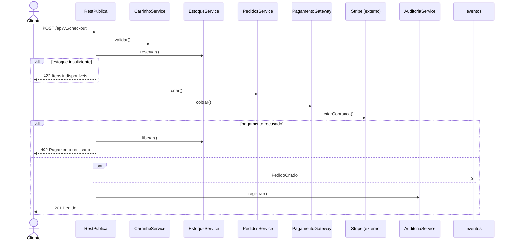
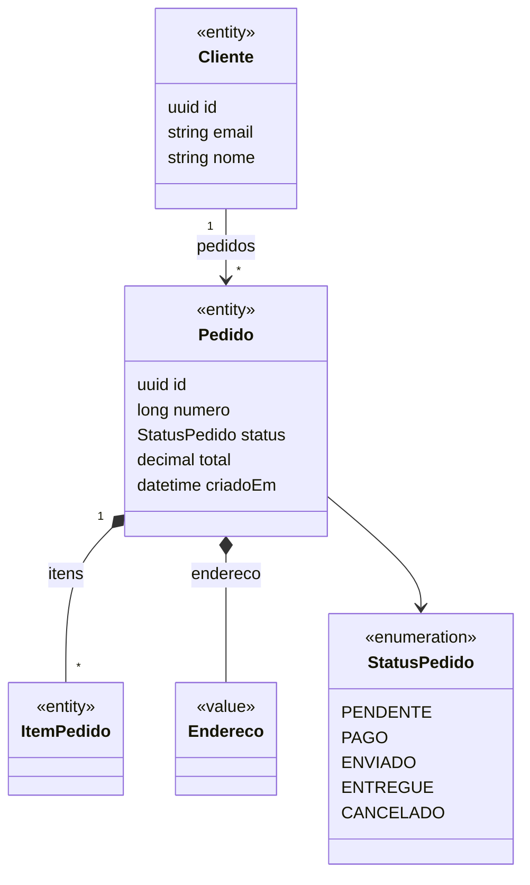

# Planta — Linguagem de Especificação Arquitetural Ancorada em Código

**Versão do documento:** 0.1 (rascunho de design)
**Data:** outubro de 2026
**Status:** proposta

> *Planta* é o nome sugerido para a linguagem: em português, "planta" é o desenho técnico de uma construção, a representação fiel da estrutura que existe (ou vai existir) no terreno. O nome, a extensão `.planta` e o comando `planta` são sugestões e podem ser trocados sem afetar o resto do design.

---

## Sumário

1. [Visão geral](#1-visão-geral)
2. [Princípios de design](#2-princípios-de-design)
3. [Conceitos fundamentais](#3-conceitos-fundamentais)
4. [Estrutura no projeto](#4-estrutura-no-projeto)
5. [Guia rápido](#5-guia-rápido)
6. [Referência da linguagem](#6-referência-da-linguagem)
7. [Gramática formal (ANTLR4)](#7-gramática-formal-antlr4)
8. [Semântica e modelo intermediário](#8-semântica-e-modelo-intermediário)
9. [Âncoras: o vínculo com o código real](#9-âncoras-o-vínculo-com-o-código-real)
10. [Extratores](#10-extratores)
11. [Validador](#11-validador)
12. [O arquivo `planta.lock` e o ciclo de revisão](#12-o-arquivo-plantalock-e-o-ciclo-de-revisão)
13. [Visualizações e diagramas](#13-visualizações-e-diagramas)
14. [Rastreabilidade de requisitos](#14-rastreabilidade-de-requisitos)
15. [Integração com IA](#15-integração-com-ia)
16. [Interface de linha de comando](#16-interface-de-linha-de-comando)
17. [Integração contínua e revisão de PR](#17-integração-contínua-e-revisão-de-pr)
18. [Suporte a editor (LSP)](#18-suporte-a-editor-lsp)
19. [Implementação de referência](#19-implementação-de-referência)
20. [Estratégias de adoção](#20-estratégias-de-adoção)
21. [Roadmap](#21-roadmap)
22. [Exemplo completo](#22-exemplo-completo)
23. [Comparação com ferramentas existentes](#23-comparação-com-ferramentas-existentes)
24. [Decisões de design e questões em aberto](#24-decisões-de-design-e-questões-em-aberto)
25. [Glossário](#25-glossário)

---

## 1. Visão geral

### 1.1 O problema

Todo projeto de software tem uma arquitetura, mas quase nenhum tem uma *descrição confiável* dela. A arquitetura existe espalhada: parte no código, parte na cabeça de quem o escreveu, parte em diagramas que pararam de ser atualizados há meses, parte em documentos de requisitos que ninguém liga ao código que os implementa.

Tentativas anteriores de resolver isso falharam por um motivo comum: **drift**. Diagramas UML, wikis de arquitetura e documentos de design eram artefatos separados, mantidos à mão, que nada verificava contra o código. Em poucas semanas, a descrição deixava de corresponder à realidade, e uma descrição que mente é pior do que nenhuma.

O problema ficou mais agudo com agentes de IA escrevendo código. Uma IA pode alterar dezenas de arquivos numa única tarefa. O humano que revisa o PR enxerga linhas mudando, mas tem dificuldade em enxergar *o que mudou na estrutura do sistema*: um novo endpoint, uma dependência que atravessa uma camada, um processo de negócio que ganhou um passo, uma entidade que ganhou um campo com dado pessoal.

### 1.2 A proposta

Planta é uma linguagem declarativa e textual para descrever a arquitetura de um sistema de software, junto com um conjunto de ferramentas que **verifica continuamente essa descrição contra o código real**.

Um projeto que usa Planta tem uma pasta `planta/` contendo arquivos `.planta`. Esses arquivos descrevem entidades, serviços, APIs, eventos, processos de negócio, aplicações de frontend, infraestrutura de nuvem, regras arquiteturais e vínculos com requisitos. Cada elemento pode apontar, por meio de uma **âncora**, para o símbolo de código que o implementa.

O validador da Planta (`planta check`) varre o código, extrai fatos sobre ele, e responde a quatro perguntas:

1. **Cobertura:** existe algo relevante no código que a planta não descreve?
2. **Integridade:** tudo que a planta descreve ainda existe no código?
3. **Drift:** algo que a planta descreve mudou desde a última vez que um humano revisou?
4. **Conformidade:** o código respeita as regras arquiteturais declaradas?

A partir do modelo validado, a Planta gera visualizações navegáveis, diagramas (UML, C4, sequência, ER, infraestrutura AWS e outros provedores), matrizes de rastreabilidade de requisitos e um servidor MCP que dá a agentes de IA uma visão estrutural do projeto.

### 1.3 Objetivos

| # | Objetivo | Como a Planta atende |
|---|----------|----------------------|
| O1 | Visualizar o projeto em nível de arquitetura de recursos | Modelo semântico único + visualizador web + views declaradas |
| O2 | Permitir que a IA altere o código enquanto o humano acompanha a estrutura | Diff arquitetural em PR, `planta.lock` com revisão humana, servidor MCP |
| O3 | Gerar diagramas automaticamente e mantê-los corretos | Diagramas são *renderizações* do modelo validado, nunca artefatos editados à mão |
| O4 | Descrever arquiteturas de nuvem e gerar suas visualizações | Bloco `deployment` com catálogo de recursos por provedor, ancorável em Terraform/CDK |
| O5 | Relacionar métodos e processos a requisitos em `.md` | `justifiedBy`, âncoras para seções Markdown, detecção de mudança em requisitos |

### 1.4 Não-objetivos

A Planta **não** é uma linguagem de programação, não gera código de produção (pelo menos não na versão 1), não substitui testes, não tenta provar formalmente a correção do sistema (como TLA+ ou Alloy) e não pretende descrever cada linha do código. Ela descreve a **estrutura** e a **intenção**, e verifica que o código continua coerente com elas.

---

## 2. Princípios de design

### P1 — Intenção é declarada, fatos são extraídos

Existem dois tipos de informação sobre um sistema. **Fatos** podem ser extraídos automaticamente do código: quais classes existem, quais rotas HTTP estão registradas, quais arquivos importam quais, quais campos uma entidade ORM tem. **Intenção** não pode ser extraída: a que contexto de negócio algo pertence, por que um método existe, qual a sequência de um processo de negócio, quais dependências são *proibidas*.

A Planta nunca obriga o humano a digitar um fato que poderia ser extraído só para mantê-lo atualizado à mão. Quando um fato é declarado na planta (por exemplo, os campos de uma entidade), é para que o validador possa conferi-lo, e as ferramentas podem gerar essa declaração automaticamente (`planta suggest`).

### P2 — Toda afirmação verificável é verificada

Se a planta afirma algo que pode ser conferido contra o código, o validador confere. Uma âncora que não resolve é um erro. Um campo declarado que não existe na entidade é um erro. Um passo de processo que referencia um método inexistente é um erro. Isso é o que impede a planta de virar documentação morta.

### P3 — Referências simbólicas, nunca posicionais

Âncoras apontam para *símbolos* (`arquivo#Classe.metodo`), nunca para linhas. Linhas mudam a cada commit; símbolos mudam raramente, e quando mudam, a mudança é significativa.

### P4 — Mudança exige revisão

Quando o código ancorado muda de forma estruturalmente relevante (assinatura de método, conjunto de campos, rota), a Planta não atualiza nada em silêncio. Ela sinaliza o elemento como "alterado desde a última revisão" até que alguém aceite a mudança explicitamente (`planta accept`). É esse ponto de controle que permite ao humano acompanhar o trabalho de uma IA.

### P5 — Legível por humanos, consumível por máquinas

A sintaxe é desenhada para ser lida em um diff de PR sem ferramentas especiais. O modelo compilado é um JSON estável e documentado, consumível por qualquer ferramenta, inclusive agentes de IA.

### P6 — Adoção incremental

Um projeto pode começar com um único contexto e um único tipo de elemento. Cobertura é configurável por tipo de elemento e por diretório. Nada obriga a descrever o sistema inteiro no primeiro dia.

### P7 — Agnóstica de framework, específica por plugin

O núcleo da linguagem não conhece NestJS, Django ou React. O conhecimento de cada framework vive em **extratores** plugáveis. A linguagem descreve conceitos arquiteturais universais (entidade, serviço, endpoint, evento, processo, página); os extratores mapeiam o código de cada framework para esses conceitos.

### P8 — Uma fonte, muitas visões

Existe um único modelo. Diagramas de classe, de sequência, C4, ER, de infraestrutura e matrizes de rastreabilidade são todos projeções desse modelo. Ninguém edita um diagrama; edita-se a planta (ou o código), e os diagramas são regenerados.

---

## 3. Conceitos fundamentais

### 3.1 Modelo

O **modelo** é o conjunto de todos os elementos declarados em todos os arquivos `.planta` de um projeto, com suas relações resolvidas. Todos os arquivos da pasta `planta/` formam um único modelo; não é necessário importar um arquivo em outro.

### 3.2 Elemento

Um **elemento** é qualquer coisa declarada na planta: um contexto, uma entidade, um serviço, uma operação, um endpoint, um evento, um processo, uma página, um recurso de nuvem, um requisito, uma regra, uma view. Todo elemento tem:

- um **identificador canônico** único no modelo (ex.: `Vendas.Cliente`, `Vendas.RestPublica.criar`);
- um **tipo** (`entity`, `service`, `endpoint`...);
- opcionalmente, uma **âncora** para o código que o implementa;
- opcionalmente, **metadados** (dono, status, tags) e **documentação**;
- **relações** com outros elementos (`uses`, `calls`, `justifiedBy`, `runs`...).

### 3.3 Âncora

Uma **âncora** é uma referência de um elemento para um artefato real: um símbolo de código, um recurso Terraform, uma seção de um arquivo Markdown. Âncoras são escritas com `@` seguido de uma string:

```planta
entity Cliente @"clientes/cliente.entity.ts#Cliente"
```

### 3.4 Fato

Um **fato** é uma informação extraída automaticamente do código por um extrator: "existe uma rota `POST /clientes` tratada por `ClientesController.criar`", "a classe `Cliente` é uma entidade TypeORM com os campos `id`, `email`, `nome`", "o arquivo `a.ts` importa `b.ts`".

### 3.5 Correspondência (*matching*)

O validador tenta associar cada fato relevante a um elemento do modelo, primeiro pela âncora explícita, depois por convenção (nome e localização). Fatos sem elemento correspondente são **lacunas de cobertura**. Elementos sem fato correspondente são **âncoras quebradas** (ou elementos planejados, se marcados como tal).

### 3.6 Impressão digital (*fingerprint*)

Para cada elemento ancorado, o validador calcula impressões digitais do código correspondente: uma da **assinatura** (o que o símbolo promete ao mundo) e uma do **corpo** (como ele cumpre). Essas impressões são gravadas no `planta.lock` quando um humano revisa o elemento. Divergências entre a impressão atual e a gravada são **drift**.

### 3.7 Extrator

Um **extrator** é um plugin que sabe ler o código de um framework específico e produzir fatos. Exemplos: `nestjs`, `django`, `prisma`, `typeorm`, `react`, `nextjs`, `terraform`, `aws-cdk`, `markdown-requirements`.

### 3.8 Diagnóstico

Um **diagnóstico** é um resultado do validador: erro, aviso, informação ou sugestão, sempre com código (ex.: `PL301`), local na planta e/ou no código, mensagem e, quando possível, correção automática.

### 3.9 View

Uma **view** é uma projeção nomeada do modelo usada para gerar um diagrama: quais elementos incluir, qual tipo de diagrama, qual estilo.

---

## 4. Estrutura no projeto

### 4.1 Layout da pasta

```
meu-projeto/
├── apps/
│   ├── api/                  # código NestJS
│   └── web/                  # código React
├── infra/
│   └── terraform/
├── docs/
│   ├── requisitos/           # requisitos em Markdown
│   └── adr/                  # decisões arquiteturais
└── planta/
    ├── planta.config.yaml    # configuração: extratores, cobertura, caminhos
    ├── planta.lock           # impressões digitais revisadas (versionado!)
    ├── sistema.planta        # declaração do sistema, camadas, atores
    ├── contextos/
    │   ├── vendas.planta
    │   └── catalogo.planta
    ├── apps/
    │   ├── api.planta
    │   └── web.planta
    ├── infra/
    │   └── producao.planta
    ├── regras.planta
    ├── views.planta
    └── .gerado/              # ignorado pelo git
        ├── modelo.json
        └── diagramas/
```

A organização interna da pasta é livre: todos os arquivos `.planta` sob `planta/` (recursivamente) são carregados. A estrutura acima é apenas a convenção recomendada.

### 4.2 O que vai para o controle de versão

Os arquivos `.planta`, o `planta.config.yaml` e o `planta.lock` **devem** ser versionados. O diretório `.gerado/` **não** deve; ele é reconstruído a cada execução.

### 4.3 `planta.config.yaml`

```yaml
version: 1
system: Loja

# Raiz a partir da qual caminhos absolutos ("/...") são resolvidos.
projectRoot: ..

extractors:
  - use: nestjs
    root: apps/api/src
    tsconfig: apps/api/tsconfig.json
  - use: typeorm
    root: apps/api/src
  - use: react
    root: apps/web/src
    router: react-router
  - use: terraform
    root: infra/terraform
  - use: markdown-requirements
    paths: ["docs/requisitos/**/*.md"]
    idPattern: "REQ-\\d{3}"
  - use: markdown-decisions
    paths: ["docs/adr/*.md"]
    idPattern: "ADR-\\d{4}"

coverage:
  # Tipos de fato que precisam ter elemento correspondente na planta.
  require:
    - entity
    - http.endpoint
    - event.handler
    - job
    - ui.page
  # Tipos que geram apenas aviso quando não cobertos.
  warn:
    - service
    - ui.component
  ignore:
    - "**/*.spec.ts"
    - "**/*.test.tsx"
    - "apps/api/src/health/**"

drift:
  signatureChange: error     # assinatura mudou sem revisão
  bodyChange: info           # implementação mudou sem revisão
  requirementChange: warning # texto do requisito mudou

anchors:
  inferByConvention: true    # tenta casar elementos sem âncora por nome
  requireExplicit: false     # se true, toda âncora inferida vira aviso

render:
  output: .gerado/diagramas
  formats: [mermaid, svg]

review:
  # Quem pode aceitar mudanças no lock (ver seção 12 e 15).
  forbidAgentAccept: true
```

---

## 5. Guia rápido

Suponha uma API NestJS com um módulo de clientes. O código:

```ts
// apps/api/src/vendas/clientes/cliente.entity.ts
@Entity()
export class Cliente {
  @PrimaryGeneratedColumn('uuid') id: string;
  @Column({ unique: true, length: 255 }) email: string;
  @Column() nome: string;
  @OneToMany(() => Pedido, p => p.cliente) pedidos: Pedido[];
}

// apps/api/src/vendas/clientes/clientes.controller.ts
@Controller('clientes')
export class ClientesController {
  constructor(private readonly service: ClientesService) {}

  @Post()
  criar(@Body() dto: CriarClienteDto): Promise<Cliente> {
    return this.service.criar(dto);
  }
}
```

A planta correspondente (as camadas `apresentacao` e `aplicacao` são declaradas em `sistema.planta`; `Pedido`, `ClienteRepository` e os DTOs são declarados no mesmo contexto e foram omitidos aqui por brevidade):

```planta
// planta/contextos/vendas.planta

/// Tudo relacionado a clientes, pedidos e pagamentos.
context Vendas root "/apps/api/src/vendas" {

  entity Cliente @"clientes/cliente.entity.ts#Cliente" {
    id: uuid key
    email: string unique max(255)
    nome: string
    pedidos: Pedido[] inverse(cliente)
  }

  controller ClientesController @"clientes/clientes.controller.ts#ClientesController" in layer apresentacao {
    op criar(dto: CriarClienteDto) -> Cliente
    uses ClientesService
  }

  service ClientesService @"clientes/clientes.service.ts#ClientesService" in layer aplicacao {
    op criar(dto: CriarClienteDto) -> Cliente
    op validarEmail(email: string) -> bool
    uses ClienteRepository
  }

  api RestPublica http base "/api/v1" {
    endpoint POST "/clientes" => ClientesController.criar {
      body CriarClienteDto
      returns 201 Cliente
      returns 409 ErroConflito
      justifiedBy "REQ-001"
    }
  }

  channel eventos kind queue

  event ClienteCadastrado via eventos {
    clienteId: uuid
    email: string
  }

  process CadastrarCliente {
    justifiedBy "REQ-001"
    trigger RestPublica.criar

    step validar: ClientesService.validarEmail
    if "e-mail já cadastrado" {
      fail 409 "Conflito"
    }
    step persistir: ClienteRepository.salvar
    step notificar: emit ClienteCadastrado
    return Cliente
  }
}
```

Executando:

```console
$ planta check
✔ 14 elementos, 14 âncoras resolvidas
✖ PL301 cobertura: rota GET /clientes/:id (ClientesController.buscar) não está descrita na planta
    → apps/api/src/vendas/clientes/clientes.controller.ts:18
    sugestão: planta suggest --fact http.endpoint:GET:/clientes/:id
⚠ PL611 requisito REQ-001 foi alterado desde a última revisão de Vendas.CadastrarCliente
✔ 3 regras verificadas, 0 violações

1 erro, 1 aviso
```

```console
$ planta render CadastroSequencia
→ .gerado/diagramas/CadastroSequencia.mmd
→ .gerado/diagramas/CadastroSequencia.svg
```

---

## 6. Referência da linguagem

Esta seção descreve cada construção da linguagem. A gramática formal completa está na [seção 7](#7-gramática-formal-antlr4).

### 6.1 Léxico

**Codificação.** Arquivos `.planta` são UTF-8. Identificadores podem conter letras ASCII, dígitos e `_`, e não podem começar com dígito. Recomenda-se não usar acentos em identificadores, para facilitar o casamento com nomes de código.

**Comentários.**

```planta
// comentário de linha (ignorado)
/* comentário de bloco (ignorado) */
/// comentário de documentação: anexado ao elemento seguinte
```

Comentários de documentação (`///`) são preservados no modelo e aparecem em diagramas, no visualizador, no hover do editor e nas respostas do servidor MCP.

**Literais.**

| Tipo | Exemplos |
|------|----------|
| String | `"texto"`, `"com \"aspas\" escapadas"` |
| Número | `42`, `3.14` |
| Booleano | `true`, `false` |
| Método HTTP | `GET`, `POST`, `PUT`, `PATCH`, `DELETE`, `HEAD`, `OPTIONS` |

**Nomes qualificados.** Elementos são referenciados por nomes separados por ponto: `Vendas.Cliente`, `Vendas.RestPublica.criar`, `producao.api`. Dentro de um contexto, nomes do próprio contexto podem ser usados sem qualificação.

**Palavras reservadas contextuais.** A maioria das palavras-chave pode ser usada como nome de campo ou de elemento quando não houver ambiguidade (por exemplo, um campo chamado `version` ou `event`). A lista completa está em [6.19](#619-palavras-reservadas).

### 6.2 Arquivos, escopo e nomes

Todos os arquivos `.planta` sob a pasta `planta/` formam um único modelo. A ordem dos arquivos não importa, e um elemento pode referenciar outro declarado em qualquer arquivo.

A resolução de nomes segue esta ordem:

1. elementos declarados no mesmo bloco (ex.: operações do mesmo serviço);
2. elementos do bloco pai, subindo até o contexto ou app;
3. elementos declarados com `use` no topo do arquivo;
4. elementos de nível superior (contextos, apps, atores, externos, camadas, requisitos, deployments).

A diretiva `use` cria um atalho local ao arquivo:

```planta
use Catalogo.Produto
use Vendas.RestPublica as Api

context Vendas {
  entity ItemPedido {
    produto: Produto // resolve para Catalogo.Produto
  }
}
```

Um mesmo contexto pode ser declarado em vários arquivos; as declarações são mescladas. Elementos com o mesmo identificador canônico declarados duas vezes geram erro `PL102`.

### 6.3 Metadados e documentação

Qualquer elemento pode ser precedido por comentários de documentação e por um bloco de anotações `#[...]`:

```planta
/// Dados cadastrais do cliente.
/// Contém dado pessoal sujeito à LGPD.
#[owner("time-vendas"), tag(pii), tag(lgpd), since("2026-03")]
entity Cliente @"clientes/cliente.entity.ts#Cliente" { ... }
```

Anotações padronizadas:

| Anotação | Significado |
|----------|-------------|
| `owner("time")` | Time ou pessoa responsável. Herdada pelos filhos. |
| `status(planned)` | Elemento planejado, ainda não implementado. Âncora não é exigida; a ausência no código gera apenas informação (`PL205`). |
| `status(active)` | Padrão. Elemento implementado e verificado. |
| `status(deprecated)` | Em descontinuação. Gera aviso em quem depende dele (`PL510`). |
| `status(experimental)` | Implementado, mas excluído das regras de cobertura estrita. |
| `tag(nome)` | Marcador livre, usado em filtros de views, regras e consultas. |
| `since("data")` | Data ou versão de introdução. |
| `ignore(drift)` / `ignore(coverage)` | Suprime categorias de diagnóstico para o elemento. Exige justificativa: `ignore(drift, "gerado automaticamente")`. |
| `stereotype("nome")` | Estereótipo exibido em diagramas UML. |

Anotações desconhecidas são preservadas no modelo e ficam disponíveis para plugins, extratores e regras.

### 6.4 `system`

Declara o sistema descrito pela planta. Deve existir exatamente um por modelo.

```planta
system Loja {
  description "Plataforma de comércio eletrônico da ACME"
  owner "arquitetura@acme.com"
  version "2.3"
}
```

### 6.5 `layer`

Declara camadas arquiteturais. Uma camada pode ter padrões de caminho (`match`) que atribuem arquivos a ela automaticamente; elementos também podem se declarar membros de uma camada com `in layer`.

```planta
layer apresentacao match "**/*.controller.ts", "**/*.resolver.ts"
layer aplicacao    match "**/*.service.ts", "**/*.usecase.ts"
layer dominio      match "**/*.entity.ts", "**/domain/**"
layer infra        match "**/*.repository.ts", "**/infra/**"
```

Camadas são usadas por regras (seção 6.17) e por views. A atribuição explícita (`in layer`) tem precedência sobre `match`.

### 6.6 `actor` e `external`

**Atores** são pessoas ou sistemas que interagem com o sistema descrito, usados em processos e diagramas de contexto.

```planta
actor Visitante  "Pessoa navegando sem login"
actor Cliente    "Pessoa autenticada que compra"
actor Backoffice "Funcionário da ACME"
```

**Externos** são sistemas de terceiros. Podem declarar as operações que o sistema consome, o que permite referenciá-las em processos.

```planta
external Stripe "Gateway de pagamentos" {
  op criarCobranca(valor: decimal, token: string) -> CobrancaStripe
  op estornar(cobrancaId: string)
}

external SES "Amazon Simple Email Service" {
  op enviarEmail(para: string, assunto: string, corpo: string)
}
```

### 6.7 `context`

Um **contexto** é uma fronteira lógica de negócio (no sentido de *bounded context* do DDD). Agrupa entidades, componentes, APIs, eventos e processos.

```planta
context Vendas root "/apps/api/src/vendas" {
  // entidades, serviços, apis, eventos, processos...
}
```

A cláusula `root` define a pasta base para âncoras relativas dentro do contexto. Caminhos iniciados por `/` são relativos à raiz do projeto (`projectRoot` no config); os demais são relativos ao `root` mais próximo.

Contextos são lógicos. A unidade física (o que é compilado e implantado) é o `app` (seção 6.14). Um app pode conter vários contextos, e um contexto pode estar espalhado por vários apps (por exemplo, o contexto `Vendas` tem código na API e páginas no frontend).

### 6.8 Tipos

Tipos aparecem em campos, parâmetros e retornos.

**Primitivos:** `string`, `text`, `int`, `long`, `decimal`, `float`, `bool`, `uuid`, `date`, `time`, `datetime`, `duration`, `json`, `bytes`, `email`, `url`, `void`.

**Compostos:**

| Forma | Significado |
|-------|-------------|
| `T` | obrigatório, um |
| `T?` | opcional |
| `T[]` | lista |
| `T[]?` | lista opcional |
| `Map<K, V>` | mapa (apenas em DTOs e eventos) |

**Referências:** qualquer `entity`, `value`, `enum`, `dto` ou `event` pode ser usado como tipo. Quando um campo de uma entidade tem como tipo outra entidade, isso é uma **relação** (usada em diagramas de classe e ER).

**Mapeamento para o código.** Os extratores mapeiam tipos nativos para os primitivos da Planta (por exemplo, `string` do TypeScript com `@Column('uuid')` vira `uuid`; `models.DecimalField` do Django vira `decimal`). Quando o mapeamento é ambíguo, a comparação é tolerante (ver [11.4](#114-comparação-estrutural)).

### 6.9 Modelo de dados: `entity`, `value`, `enum`, `dto`, `aggregate`

#### `entity`

Objeto com identidade e ciclo de vida, normalmente persistido.

```planta
entity Pedido @"pedidos/pedido.entity.ts#Pedido" {
  id: uuid key
  numero: long unique
  cliente: Cliente inverse(pedidos)
  itens: ItemPedido[] inverse(pedido) cascade
  status: StatusPedido default(PENDENTE)
  total: decimal precision(12, 2)
  endereco: Endereco               // value object, embutido
  criadoEm: datetime default(now)
  observacao: text?
}
```

**Modificadores de campo** são escritos depois do tipo, separados por espaço. São livres na gramática (`nome` ou `nome(args)`), e os seguintes têm semântica padrão:

| Modificador | Significado |
|-------------|-------------|
| `key` | Chave primária |
| `unique` | Valor único |
| `index` | Indexado |
| `max(n)`, `min(n)` | Tamanho ou valor máximo/mínimo |
| `precision(p, s)` | Precisão decimal |
| `default(v)` | Valor padrão (`now`, `uuid`, literal ou valor de enum) |
| `inverse(campo)` | Lado inverso de uma relação bidirecional |
| `cascade` | Operações em cascata |
| `readonly` | Não alterável após criação |
| `computed` | Campo derivado, não persistido |
| `sensitive` | Dado sensível; atalho para `tag(pii)` no campo |

Se a entidade tem âncora, o validador compara os campos declarados com os extraídos (`PL410`–`PL414`). Campos podem ser omitidos completamente: `entity Pedido @"..."` sem bloco é válido, e nesse caso o validador apenas confirma a existência e usa os campos extraídos para gerar diagramas. Declarar campos serve para *fixar* o contrato: qualquer mudança passa a exigir revisão.

#### `value`

Objeto de valor, sem identidade própria.

```planta
value Endereco @"shared/endereco.ts#Endereco" {
  logradouro: string
  numero: string
  cep: string max(9)
  cidade: string
  uf: string max(2)
}
```

#### `enum`

```planta
enum StatusPedido @"pedidos/status.ts#StatusPedido" {
  PENDENTE, PAGO, ENVIADO, ENTREGUE, CANCELADO
}
```

#### `dto`

Objeto de transferência, usado em APIs e eventos.

```planta
dto CriarClienteDto @"clientes/dto/criar-cliente.dto.ts#CriarClienteDto" {
  email: email
  nome: string max(120)
}
```

#### `aggregate`

Agrupa entidades sob uma raiz de agregado (DDD). Usado por regras (por exemplo, "repositórios só existem para raízes de agregado") e por diagramas.

```planta
aggregate PedidoAgg root Pedido {
  contains ItemPedido, Pagamento
}
```

### 6.10 Componentes e operações

Componentes são unidades de código com responsabilidade definida. A Planta oferece tipos de componente com semântica padronizada:

| Palavra-chave | Uso típico |
|---------------|------------|
| `controller` | Recebe requisições (HTTP, GraphQL, RPC) |
| `service` | Lógica de aplicação ou de domínio |
| `repository` | Acesso a dados |
| `gateway` | Cliente de sistema externo |
| `middleware` | Interceptação de requisições |
| `guard` | Autorização/autenticação |
| `component` | Genérico; no frontend, componente de UI |
| `page` | Página/tela de frontend |
| `store` | Estado global de frontend (Redux, Zustand, Pinia...) |

Sintaxe:

```planta
service PedidosService @"pedidos/pedidos.service.ts#PedidosService" in layer aplicacao {
  /// Cria um pedido a partir do carrinho atual do cliente.
  op criar(clienteId: uuid, itens: ItemDto[]) -> Pedido justifiedBy "REQ-010"
  op cancelar(pedidoId: uuid, motivo: string) -> Pedido justifiedBy "REQ-014"
  op calcularTotal(pedido: Pedido) -> decimal

  uses PedidoRepository, EstoqueService, PagamentoGateway
  implements PedidosPort
}

repository PedidoRepository @"pedidos/pedido.repository.ts#PedidoRepository" in layer infra {
  op salvar(p: Pedido) -> Pedido
  op buscarPorId(id: uuid) -> Pedido?
}

gateway PagamentoGateway @"pagamentos/stripe.gateway.ts#StripeGateway" in layer infra {
  op cobrar(valor: decimal, token: string) -> Cobranca
  uses Stripe
}
```

**Âncora herdada de operações.** Uma operação sem âncora herda a do componente, acrescida do seu nome: dentro de `PedidosService @"pedidos/pedidos.service.ts#PedidosService"`, a operação `criar` resolve para `pedidos/pedidos.service.ts#PedidosService.criar`. Âncora explícita só é necessária quando o nome difere:

```planta
op criar(...) -> Pedido @"#PedidosService.create"   // "#" = mesmo arquivo do pai
```

**Cláusulas de componente:**

| Cláusula | Significado | Verificável? |
|----------|-------------|--------------|
| `uses A, B` | Depende de A e B | Sim: o extrator confere injeção de dependência e imports |
| `calls Api.endpoint` | Chama um endpoint (típico de frontend) | Sim: o extrator procura chamadas HTTP com método e rota |
| `renders C1, C2` | Renderiza componentes de UI | Sim: JSX/templates |
| `implements Porta` | Implementa uma interface/porta | Sim |
| `in layer x` | Pertence à camada x | Sim, contra `match` e regras |
| `justifiedBy` / `decidedBy` | Rastreabilidade (seção 6.15) | Sim: o requisito precisa existir |

**Dependências não declaradas.** Se o extrator encontra uma dependência real (por exemplo, `PedidosService` injeta `NotificacaoService`) que não está em `uses`, o validador gera `PL420` (dependência não declarada). Isso torna visível, no diff, quando uma IA introduz um acoplamento novo.

### 6.11 `api` e `endpoint`

Uma `api` agrupa endpoints que compartilham protocolo e prefixo.

```planta
api RestPublica http base "/api/v1" {

  #[tag(publico)]
  endpoint POST "/clientes" => ClientesController.criar {
    body CriarClienteDto
    returns 201 Cliente
    returns 409 ErroConflito
    justifiedBy "REQ-001"
  }

  endpoint buscarCliente GET "/clientes/:id" => ClientesController.buscar {
    param id: uuid in path
    returns 200 Cliente
    returns 404
    auth bearer roles [cliente, admin]
  }

  endpoint GET "/pedidos" => PedidosController.listar {
    param pagina: int? in query
    param status: StatusPedido? in query
    returns 200 Pedido[]
    auth bearer
  }
}

api Interna graphql base "/graphql" {
  endpoint query "relatorioVendas" => RelatoriosResolver.vendas
  endpoint mutation "reprocessarPedido" => RelatoriosResolver.reprocessar
}
```

**Protocolos:** `http`, `graphql`, `grpc`, `websocket`.

**Nome do endpoint.** O nome é opcional; quando omitido, é o nome da operação do handler (`ClientesController.criar` → `criar`). O identificador canônico fica `Vendas.RestPublica.criar`. Se dois endpoints da mesma API resultarem no mesmo nome, é obrigatório nomear explicitamente (`PL104`).

**Itens de endpoint:**

| Item | Significado |
|------|-------------|
| `body T` | Corpo da requisição |
| `param nome: T in path\|query\|header` | Parâmetro |
| `returns status T?` | Resposta possível (pode repetir) |
| `auth esquema roles [r1, r2]` | Autenticação/autorização |
| `rateLimit "100/min"` | Limite declarado |
| `justifiedBy`, `decidedBy` | Rastreabilidade |

O extrator HTTP confere método, rota completa (base + caminho), handler e, quando possível, tipos de `body`, `param` e status de resposta (via decorators, OpenAPI gerado ou anotações do framework).

### 6.12 Mensageria e agendamento: `channel`, `event`, `on`, `job`

```planta
/// Fila principal de eventos de domínio.
channel eventos kind queue @"/apps/api/src/infra/filas.ts#EVENTOS_QUEUE"
channel notificacoes kind topic

event PedidoCriado via eventos @"pedidos/eventos/pedido-criado.event.ts#PedidoCriado" {
  pedidoId: uuid
  clienteId: uuid
  total: decimal
}

event PagamentoConfirmado via eventos

/// Consumidores de eventos.
on PedidoCriado => EstoqueListener.reservar
on PedidoCriado => EmailListener.enviarConfirmacao
on PagamentoConfirmado => PedidosService.marcarComoPago

/// Tarefas agendadas.
job ExpirarCarrinhos cron "0 3 * * *" => CarrinhoJobs.expirar
job ConciliarPagamentos cron "*/15 * * * *" => PagamentosJobs.conciliar
```

`kind` de canal: `queue`, `topic`, `stream`, `bus`. Canais são lógicos; o mapeamento para SQS, SNS, Kafka, RabbitMQ etc. acontece no `deployment` (seção 6.16).

O validador confere que cada `on` corresponde a um consumidor real (decorators como `@OnEvent`, `@EventPattern`, `@SqsMessageHandler`, ou registros equivalentes em outros frameworks) e que cada evento declarado é **emitido** em algum lugar do código (`PL332`, aviso).

### 6.13 `process`

Processos descrevem fluxos de negócio: a sequência de passos que acontece quando algo é disparado. São a construção que mais carrega intenção, porque raramente podem ser extraídos por inteiro do código.

```planta
/// Do carrinho até o pedido pago.
#[owner("time-checkout")]
process FinalizarCompra {
  justifiedBy "REQ-010", "REQ-011"
  actor Cliente
  trigger RestPublica.finalizarCompra
  verify calls

  step validarCarrinho: CarrinhoService.validar
  step reservarEstoque: EstoqueService.reservar

  if "estoque insuficiente" {
    fail 422 "Itens indisponíveis"
  }

  step criarPedido: PedidosService.criar
  step cobrar: PagamentoGateway.cobrar

  if "pagamento recusado" {
    step liberarEstoque: EstoqueService.liberar
    fail 402 "Pagamento recusado"
  } else {
    parallel {
      step publicar: emit PedidoCriado
      step registrarAuditoria: AuditoriaService.registrar
    }
  }

  return Pedido
}

process EntregarPedido {
  justifiedBy "REQ-020"
  trigger PagamentoConfirmado

  step separar: "Separação manual no centro de distribuição"
  step despachar: LogisticaGateway.criarEnvio
  wait EntregaConfirmada timeout "7d"
  step concluir: PedidosService.marcarComoEntregue
}
```

**Instruções de processo:**

| Instrução | Significado |
|-----------|-------------|
| `trigger X` | O que inicia o processo: endpoint, evento, job ou ator |
| `actor A` | Ator envolvido |
| `step nome: Alvo` | Passo que executa uma operação (`Componente.op`, `Externo.op`) |
| `step nome: emit Evento` | Passo que publica um evento |
| `step nome: "descrição"` | Passo manual ou não implementado em código |
| `emit Evento` | Publicação sem nomear o passo |
| `if "condição" { } else { }` | Desvio. A condição é texto livre, para humanos |
| `parallel { }` | Passos concorrentes |
| `foreach "descrição" { }` | Repetição |
| `wait Evento timeout "duração"` | Espera por um evento |
| `fail status? "mensagem"` | Término com erro |
| `return T?` | Término com sucesso |
| `verify calls` / `verify order` | Nível de verificação estática (ver abaixo) |

**Verificação de processos.** Por padrão (sem `verify`), o validador confere que todo alvo referenciado existe. Com `verify calls`, ele usa o grafo de chamadas extraído para conferir que, partindo do handler do `trigger`, cada passo é alcançável. Com `verify order`, ele também confere a ordem relativa dos passos quando estão no mesmo fluxo de controle. Essas verificações são de melhor esforço e seus limites estão descritos em [11.6](#116-verificação-de-processos).

### 6.14 `app` e `route`

Um `app` é uma unidade física de código: algo que é compilado, empacotado e implantado. Pode ser backend, frontend, worker, função serverless, aplicativo móvel ou biblioteca.

```planta
app Api kind backend framework nestjs root "/apps/api/src" {
  contains Vendas, Catalogo, Identidade
}

app Worker kind worker framework nestjs root "/apps/worker/src" {
  contains Vendas.EstoqueListener, Vendas.EmailListener
}

app Web kind spa framework react root "/apps/web/src" {

  route "/" => Home
  route "/produtos/:slug" => DetalheProduto
  route "/carrinho" => Carrinho
  route "/checkout" => Checkout guard Autenticado
  route "/conta/*" => AreaDoCliente guard Autenticado

  page Home @"pages/Home.tsx#Home" {
    renders VitrineProdutos, BannerPromocoes
    calls Catalogo.RestCatalogo.destaques
  }

  page Checkout @"pages/Checkout.tsx#Checkout" {
    renders FormEndereco, ResumoPedido, FormPagamento
    calls Vendas.RestPublica.finalizarCompra
    uses sessao, carrinho
    justifiedBy "REQ-010"
  }

  component FormPagamento @"components/checkout/FormPagamento.tsx#FormPagamento" {
    uses Stripe // SDK de cliente
  }

  store sessao @"stores/sessao.ts#useSessao"
  store carrinho @"stores/carrinho.ts#useCarrinho"

  guard Autenticado @"routes/guards.tsx#RequireAuth"
}
```

`kind`: `backend`, `frontend`, `spa`, `ssr`, `worker`, `function`, `mobile`, `library`, `cli`.

`contains` declara quais contextos (ou elementos específicos) vivem fisicamente naquele app. O validador usa isso para conferir que as âncoras dos elementos estão sob o `root` do app (`PL230`).

No frontend, o extrator confere rotas registradas no roteador, componentes renderizados por cada página (`renders`), chamadas HTTP (`calls`, casando método e rota com os endpoints declarados) e uso de stores. Um `calls` que aponta para um endpoint não declarado é erro de ligação (`PL110`), e uma chamada HTTP encontrada no código do frontend que não corresponde a nenhum endpoint declarado é erro `PL240`: é a forma de detectar que o frontend e o backend se desalinharam. Rotas registradas sem `route` são `PL320`; uma `route` que o código não registra, ou que leva a outro componente, ou com outro guard, é `PL321` (inclusive quando o código deixa de aplicar o guard que a planta exige). `calls`, `renders` e `uses` de stores são conferidos nos dois sentidos: o que o código faz e a planta não declara é `PL241`; o que a planta declara e o código não faz, `PL242`.

### 6.15 Rastreabilidade: `requirement`, `decision`, `justifiedBy`, `decidedBy`

Requisitos e decisões vivem em arquivos Markdown. A Planta pode descobri-los automaticamente (por padrão de ID configurado no extrator `markdown-requirements`) ou declará-los explicitamente quando o Markdown não tem IDs.

**Descoberta automática.** Com `idPattern: "REQ-\\d{3}"`, qualquer título Markdown que comece com um ID vira um requisito referenciável:

```markdown
<!-- docs/requisitos/clientes.md -->

## REQ-001 Cadastro de cliente

O visitante deve poder se cadastrar informando e-mail e nome.
O e-mail deve ser único no sistema.

### Critérios de aceite
- E-mail duplicado retorna erro de conflito.
- Após o cadastro, um e-mail de boas-vindas é enviado.
```

Referência na planta, por string:

```planta
justifiedBy "REQ-001"
```

**Declaração explícita.** Para documentos sem IDs:

```planta
requirement CadastroCliente @"md:/docs/requisitos/clientes.md#cadastro-de-cliente"
  "Cadastro de cliente"

decision UsarFilaParaEmails @"md:/docs/adr/0007-filas-para-email.md"
  "E-mails transacionais são enviados de forma assíncrona"
```

Referência por nome:

```planta
justifiedBy CadastroCliente
decidedBy UsarFilaParaEmails
```

`justifiedBy` responde a "por que isto existe?" e liga o elemento a um requisito. `decidedBy` responde a "por que foi feito deste jeito?" e liga o elemento a uma decisão arquitetural (ADR). Ambas aceitam listas e podem aparecer em qualquer elemento: operação, endpoint, processo, entidade, campo, página, recurso de nuvem.

Veja a [seção 14](#14-rastreabilidade-de-requisitos) para o funcionamento completo.

### 6.16 `deployment`

Descreve como o sistema é implantado: recursos de nuvem, redes, conexões e o que roda onde.

```planta
deployment producao provider aws region "sa-east-1" source terraform "/infra/terraform/envs/prod" {

  usuarios: actor.internet

  cdn: aws.cloudfront @"tf:aws_cloudfront_distribution.web"
  site: aws.s3 runs Web @"tf:aws_s3_bucket.web"

  network vpc: aws.vpc @"tf:module.vpc" {

    zone publica {
      lb: aws.alb @"tf:aws_lb.api"
    }

    zone privada {
      cluster ecs: aws.ecs.cluster @"tf:aws_ecs_cluster.main" {
        api: aws.ecs.service runs Api replicas 3 @"tf:aws_ecs_service.api" {
          cpu = 1024
          memory = 2048
        }
        worker: aws.ecs.service runs Worker replicas 2 @"tf:aws_ecs_service.worker"
      }

      db: aws.rds.postgres stores Vendas, Catalogo @"tf:aws_db_instance.main" {
        instance = "db.r6g.large"
        multiAz = true
      }

      cache: aws.elasticache.redis @"tf:aws_elasticache_cluster.cache"
    }
  }

  filaEventos: aws.sqs carries Vendas.eventos @"tf:aws_sqs_queue.eventos"
  email: aws.ses
  segredos: aws.secretsmanager

  usuarios -> cdn -> site
  usuarios -> lb "HTTPS 443"
  lb -> api "HTTP 3000"
  api -> db "TCP 5432"
  api -> cache "TCP 6379"
  api -> filaEventos
  filaEventos -> worker
  worker -> email
  api -> segredos
}

deployment local provider docker source compose "/docker-compose.yml" {
  api: docker.container runs Api @"compose:api"
  db: docker.container stores Vendas, Catalogo @"compose:postgres"
  api -> db
}
```

**Tipos de recurso** são nomes qualificados de um catálogo por provedor (`aws.*`, `gcp.*`, `azure.*`, `k8s.*`, `docker.*`, `generic.*`). O catálogo define ícone, categoria e quais propriedades são reconhecidas. Tipos desconhecidos são aceitos com aviso (`PL150`) e renderizados com ícone genérico.

**Agrupadores:** `network`, `zone`, `cluster`, `group`, `region`. Podem ser aninhados e viram contêineres no diagrama.

**Cláusulas de nó:**

| Cláusula | Significado |
|----------|-------------|
| `runs App` | O recurso executa um app da planta |
| `stores Ctx1, Ctx2` | O recurso persiste dados dos contextos |
| `carries canal` | O recurso implementa um canal lógico |
| `replicas n` | Réplicas declaradas |
| `{ prop = valor }` | Propriedades livres, conferidas contra o IaC quando possível |

**Conexões** são escritas com `->` e podem ser encadeadas (`a -> b -> c`) e rotuladas com uma string.

**Ancoragem em IaC.** Com `source terraform "<caminho>"`, âncoras `tf:` apontam para endereços de recursos Terraform. O extrator `terraform` lê o HCL (e opcionalmente o `terraform show -json` de um plano) e confere existência, tipo e propriedades declaradas. O mesmo vale para `cdk:` (caminho do construct), `k8s:` (`kind/namespace/nome`), `compose:` (nome do serviço) e `pulumi:` (URN). O validador também reporta recursos de IaC que não aparecem em nenhum `deployment` como lacuna de cobertura, se `iac.resource` estiver em `coverage.require`.

Na verificação contra o IaC, válida para `tf:`, `cdk:`, `k8s:` e `compose:` (o catálogo diz, por ferramenta, os tipos e os nomes de propriedade de cada tipo de recurso: `AWS::ECS::Service`/`DesiredCount` no CDK, `Deployment`/`replicas` no Kubernetes):

- O endereço é resolvido dentro da pasta do `source` (o ambiente). Módulos locais entram com o prefixo de endereço do `terraform state` (`module.vpc.aws_vpc.this`); índices (`[0]`) são ignorados. Endereço inexistente é `PL201`; pasta sem nenhum recurso, `PL202` (um por deployment).
- O catálogo diz quais tipos Terraform implementam cada tipo de recurso (`aws.alb` → `aws_lb` ou `aws_alb`); outro tipo é `PL209`. Um `module` pode implementar qualquer tipo, e os recursos dentro de um módulo ancorado contam como descritos por ele.
- `replicas` e as propriedades `{ ... }` são comparadas com os atributos pelo nome que o catálogo define (`instance` → `instance_class`, `multiAz` → `multi_az`; sem mapeamento, o nome em *snake case*). Uma propriedade pode morar em outro recurso referenciado: `cpu` de um `aws.ecs.service` vem da `task_definition`. O catálogo também pode exigir atributos (`aws.rds.postgres` exige `engine = "postgres"`). Divergência é `PL418`; atributo cujo valor é expressão (`var.x`, `aws_x.y.id`) só é conhecido no plano, e não gera diagnóstico.
- `PL340` cobra só recursos de tipos que o catálogo descreve: papéis IAM, security groups e task definitions são auxiliares e não precisam aparecer no diagrama.
- A revisão (`planta.lock`) congela os atributos e blocos internos de cada recurso ancorado: mudar a infraestrutura depois da revisão é `PL401`, como mudar a assinatura de uma operação.

### 6.17 `rule`

Regras arquiteturais são verificadas contra o modelo e contra os fatos extraídos (imports reais, chamadas reais, injeções reais).

```planta
rule CamadasLimpas severity error {
  layer apresentacao may depend on layer aplicacao
  layer aplicacao may depend on layer dominio
  layer dominio must not depend on layer infra
  layer dominio must not depend on layer apresentacao
}

rule ContextosIsolados severity error {
  context Vendas must not depend on context Catalogo except via event
  context Catalogo must not depend on context Vendas
}

rule Rastreabilidade severity warning {
  every endpoint must have justifiedBy
  every process must have justifiedBy
  every entity where tag = pii must have owner
}

rule Convencoes severity warning {
  every service must match ".*Service$"
  every repository must be in layer infra
  every controller must not depend on every repository
}

rule FrontendSemAcessoDireto severity error {
  app Web must not depend on context Vendas except via endpoint
}
```

**Forma geral:** `sujeito modalidade predicado [exceção]`.

| Parte | Formas |
|-------|--------|
| Sujeito | `every <tipo> [where <atributo> = <valor>]`, `<tipo> <Nome>` (ex.: `layer dominio`, `context Vendas`, `app Web`) |
| Modalidade | `must`, `must not`, `may` |
| Predicado | `depend on <sujeito>`, `have <propriedade>`, `match "<regex>"`, `be in layer <nome>` |
| Exceção | `except via event`, `except via endpoint`, `except via <tipo>` |

`may` define uma lista de permissões: se uma camada tem alguma regra `may depend on`, qualquer dependência fora dessa lista é violação.

As dependências avaliadas são as **reais** (extraídas), não apenas as declaradas com `uses`. Uma regra violada aponta para o import ou chamada exata no código (`PL501`).

Regras mais complexas podem ser escritas como plugins em TypeScript, recebendo o modelo e os fatos (ver [19.5](#195-api-de-plugins)).

**Como as regras são avaliadas.**

- **O grafo.** As arestas declaradas são `uses`, `calls`, `renders`, `implements`, `on` (consumo de evento), o handler de endpoints e jobs, os passos de processo e os tipos referenciados em campos, parâmetros, retornos, corpo e respostas. As reais vêm dos fatos `import` (extrator `imports`), `di`, `call`, `http.client` e `event.emit`. Deployments não entram: implantação não é dependência de código.
- **Pertencimento.** Uma ponta pertence a `layer X` pela camada do elemento (ou do ancestral mais próximo que tenha uma) ou, para um arquivo sem elemento, pelos `match` das camadas. Pertence a `context X`/`app X` se estiver dentro dele, ou se o arquivo estiver sob o `root`. `every <tipo>` vale para o elemento e para o que está dentro dele: uma operação de um controller conta como o controller.
- **Exceções.** `except via event` libera arestas de consumo e publicação de evento; `except via endpoint`, chamadas HTTP e `calls`. `except via <tipo>` libera arestas cujo alvo é desse tipo.
- **`may` é lista de permissões por sujeito**, somando todas as regras. Só se julga o que está no mesmo domínio: para camadas, uma dependência de algo sem camada (um `external`, por exemplo) não é "outra camada". Depender da própria camada é sempre permitido.
- **Um diagnóstico por par e por regra**, no nível de componente ou entidade (operações e campos contam pelo que os contém). Quando a mesma dependência é declarada e real, aponta-se a linha do código (o import, a injeção, a chamada), com a linha da regra como posição relacionada. `data` traz `rule`, `from` e `to`, que o diff arquitetural usa para marcar "❌ viola".
- **`must depend on`**: com `every`, cada elemento precisa da dependência; com sujeito nomeado, o conjunto.
- **Propriedades.** `have` vale para relação (`justifiedBy`, `decidedBy`), metadado (`owner`, `tags`) ou propriedade do elemento (`auth`, `anchor`, `docs`). `match` testa o nome do elemento. `be in layer` usa a mesma camada derivada. Elementos `planned` também respondem a essas regras.
- **Contradições e mal formadas.** `may` com predicado que não é `depend on`, expressão regular inválida, e o mesmo par permitido e proibido são `PL130`.

### 6.18 `view`

Views definem diagramas.

```planta
view Panorama kind c4.context {
  title "Loja — visão de contexto"
  include *
}

view Containers kind c4.container {
  include every app, every external, every actor
}

view ModeloVendas kind class {
  include Vendas.*
  exclude every dto
}

view BancoVendas kind er of Vendas

view FluxoCompra kind sequence of Vendas.FinalizarCompra

view FluxoCompraAtividade kind flow of Vendas.FinalizarCompra

view InfraProducao kind deployment of producao style aws

view DependenciasReais kind dependency {
  include every service, every repository
  layout lr
}

view Requisitos kind traceability {
  include every requirement, every process, every endpoint
}
```

**Tipos de view:**

| `kind` | Gera |
|--------|------|
| `c4.context`, `c4.container`, `c4.component` | Diagramas C4 |
| `class` | Diagrama de classes UML |
| `er` | Diagrama entidade-relacionamento |
| `sequence` | Diagrama de sequência UML de um processo |
| `flow` | Diagrama de atividade/fluxograma de um processo |
| `deployment` | Diagrama de infraestrutura |
| `dependency` | Grafo de dependências reais |
| `traceability` | Grafo requisito → elemento |
| `sitemap` | Rotas e páginas de um app de frontend |

Views não precisam ser declaradas para os casos comuns: `planta render --auto` gera um conjunto padrão (um C4 de contexto, um de contêineres, um diagrama de classe por contexto, uma sequência por processo e um diagrama por deployment).

### 6.19 Palavras reservadas

```
actor aggregate anchor api app as auth base be body calls carries
channel cluster component contains context controller cron decidedBy
decision depend deployment description dto else emit endpoint entity
enum event every except exclude external fail foreach framework gateway
graphql group grpc guard handler have http if implements in include job
justifiedBy kind layer layout Map match may message middleware must
mutation network not of on op owner page parallel param path process
provider query rateLimit region renders replicas repository requirement
return returns roles root route rpc rule runs service severity source
step store stores style subscription system timeout title trigger use
uses value verify version via view wait websocket where zone
```

Todas podem ser usadas como nome de campo, parâmetro ou elemento, exceto nas posições em que iniciam uma declaração (ver regra `name` na gramática).

---

## 7. Gramática formal (ANTLR4)

A gramática abaixo é a referência normativa da sintaxe. Ela foi escrita para ANTLR 4.13 e testada contra todos os exemplos completos deste documento. Pontos de atenção na leitura:

1. **Palavras-chave contextuais.** O lexer reconhece cada palavra-chave como token próprio, mas a regra `name` aceita quase todas elas como identificador. O algoritmo ALL(\*) do ANTLR4 resolve a ambiguidade pela continuação: em `api: aws.ecs.service`, `api` é nome de nó porque é seguido de `:`. Métodos HTTP (`GET`, `POST`...) e `true`/`false` não podem ser usados como nomes.
2. **Comentários de documentação** (`///`) não são descartados pelo lexer; chegam ao parser e são anexados ao elemento seguinte pela regra `meta`. Um `///` solto, sem elemento depois, é erro de sintaxe.
3. **Modificadores de campo são livres** na gramática (`name ('(' args ')')?`). A validação de quais modificadores existem e quais argumentos aceitam acontece na análise semântica, o que permite que plugins adicionem modificadores sem alterar a gramática.
4. **A gramática não resolve nomes.** Ela só reconhece a estrutura. Se `ClientesService.criar` existe, e se é de fato uma operação, é responsabilidade da fase de ligação (seção 8.2).

```antlr
grammar Planta;

// =====================================================================
//  Estrutura de arquivo
// =====================================================================

file
    : useDecl* topDecl* EOF
    ;

useDecl
    : USE qualifiedName (AS name)?
    ;

topDecl
    : meta ( systemDecl
           | layerDecl
           | actorDecl
           | externalDecl
           | contextDecl
           | appDecl
           | requirementDecl
           | decisionDecl
           | deploymentDecl
           | ruleDecl
           | viewDecl
           )
    ;

// ---------------------------------------------------------------------
//  Metadados: documentação e anotações
// ---------------------------------------------------------------------

meta
    : DOC_COMMENT* annotation*
    ;

annotation
    : '#[' annotationItem (',' annotationItem)* ']'
    ;

annotationItem
    : name ('(' literalList? ')')?
    ;

// =====================================================================
//  Declarações de nível superior
// =====================================================================

systemDecl
    : SYSTEM name '{' systemItem* '}'
    ;

systemItem
    : DESCRIPTION STRING
    | OWNER STRING
    | VERSION STRING
    ;

layerDecl
    : LAYER name (MATCH STRING (',' STRING)*)?
    ;

actorDecl
    : ACTOR name STRING?
    ;

externalDecl
    : EXTERNAL name STRING? ('{' (meta opDecl)* '}')?
    ;

requirementDecl
    : REQUIREMENT name anchor STRING?
    ;

decisionDecl
    : DECISION name anchor STRING?
    ;

// =====================================================================
//  Contextos
// =====================================================================

contextDecl
    : CONTEXT name rootClause? '{' contextMember* '}'
    ;

rootClause
    : ROOT STRING
    ;

contextMember
    : meta ( entityDecl
           | valueDecl
           | dtoDecl
           | enumDecl
           | aggregateDecl
           | componentDecl
           | apiDecl
           | channelDecl
           | eventDecl
           | handlerDecl
           | jobDecl
           | processDecl
           )
    ;

// ---------------------------------------------------------------------
//  Modelo de dados
// ---------------------------------------------------------------------

entityDecl
    : ENTITY name anchor? fieldBlock?
    ;

valueDecl
    : VALUE name anchor? fieldBlock?
    ;

dtoDecl
    : DTO name anchor? fieldBlock?
    ;

fieldBlock
    : '{' fieldBlockItem* '}'
    ;

fieldBlockItem
    : meta (fieldDecl | traceClause)
    ;

fieldDecl
    : name ':' typeRef fieldModifier* anchor?
    ;

fieldModifier
    : name ('(' literalList? ')')?
    ;

enumDecl
    : ENUM name anchor? '{' name (',' name)* ','? '}'
    ;

aggregateDecl
    : AGGREGATE name ROOT qualifiedName '{' (CONTAINS qualifiedNameList)* '}'
    ;

typeRef
    : MAP '<' typeRef ',' typeRef '>' '?'?
    | qualifiedName ('[' ']')? '?'?
    ;

// ---------------------------------------------------------------------
//  Componentes e operações
// ---------------------------------------------------------------------

componentDecl
    : componentKind name anchor? layerClause? componentBody?
    ;

componentKind
    : SERVICE | CONTROLLER | REPOSITORY | GATEWAY | MIDDLEWARE
    | GUARD | COMPONENT | PAGE | STORE
    ;

layerClause
    : IN LAYER qualifiedName
    ;

componentBody
    : '{' componentItem* '}'
    ;

componentItem
    : meta ( opDecl
           | USES qualifiedNameList
           | CALLS qualifiedNameList
           | RENDERS qualifiedNameList
           | IMPLEMENTS qualifiedNameList
           | traceClause
           )
    ;

opDecl
    : OP name '(' paramList? ')' ('->' typeRef)? anchor? traceClause*
    ;

paramList
    : param (',' param)*
    ;

param
    : name ':' typeRef
    ;

// ---------------------------------------------------------------------
//  APIs
// ---------------------------------------------------------------------

apiDecl
    : API name protocol (BASE STRING)? '{' (meta endpointDecl)* '}'
    ;

protocol
    : HTTP | GRAPHQL | GRPC | WEBSOCKET
    ;

endpointDecl
    : ENDPOINT name? operationSig '=>' qualifiedName endpointBody?
    ;

operationSig
    : HTTP_METHOD STRING
    | (QUERY | MUTATION | SUBSCRIPTION | RPC | MESSAGE) STRING
    ;

endpointBody
    : '{' endpointItem* '}'
    ;

endpointItem
    : BODY typeRef
    | PARAM name ':' typeRef (IN paramLocation)?
    | RETURNS NUMBER typeRef?
    | AUTH name (ROLES '[' name (',' name)* ']')?
    | RATE_LIMIT STRING
    | traceClause
    ;

paramLocation
    : PATH | QUERY | name
    ;

// ---------------------------------------------------------------------
//  Mensageria e agendamento
// ---------------------------------------------------------------------

channelDecl
    : CHANNEL name KIND name anchor?
    ;

eventDecl
    : EVENT name (VIA qualifiedName)? anchor? fieldBlock?
    ;

handlerDecl
    : ON qualifiedName '=>' qualifiedName traceClause*
    ;

jobDecl
    : JOB name CRON STRING '=>' qualifiedName traceClause*
    ;

// ---------------------------------------------------------------------
//  Processos
// ---------------------------------------------------------------------

processDecl
    : PROCESS name processBlock
    ;

processBlock
    : '{' processItem* '}'
    ;

processItem
    : meta processStmt
    ;

processStmt
    : traceClause                                         # procTrace
    | TRIGGER qualifiedName                               # procTrigger
    | ACTOR qualifiedName                                 # procActor
    | VERIFY (CALLS | name)                               # procVerify
    | STEP name ':' stepTarget                            # procStep
    | emitStmt                                            # procEmit
    | IF STRING processBlock (ELSE (ifTail | processBlock))?  # procIf
    | PARALLEL processBlock                               # procParallel
    | FOREACH STRING processBlock                         # procForeach
    | WAIT qualifiedName (TIMEOUT STRING)?                # procWait
    | FAIL NUMBER? STRING?                                # procFail
    | RETURN typeRef?                                     # procReturn
    ;

ifTail
    : IF STRING processBlock (ELSE (ifTail | processBlock))?
    ;

stepTarget
    : emitStmt
    | qualifiedName
    | STRING
    ;

emitStmt
    : EMIT qualifiedName
    ;

// =====================================================================
//  Apps (unidades físicas)
// =====================================================================

appDecl
    : APP name KIND name (FRAMEWORK name)? rootClause? ('{' appItem* '}')?
    ;

appItem
    : meta ( CONTAINS qualifiedNameList
           | routeDecl
           | componentDecl
           )
    ;

routeDecl
    : ROUTE STRING '=>' qualifiedName (GUARD qualifiedName)?
    ;

// =====================================================================
//  Rastreabilidade
// =====================================================================

traceClause
    : (JUSTIFIED_BY | DECIDED_BY) traceRef (',' traceRef)*
    ;

traceRef
    : STRING
    | qualifiedName
    ;

// =====================================================================
//  Deployment
// =====================================================================

deploymentDecl
    : DEPLOYMENT name (PROVIDER name)? (REGION STRING)? (SOURCE name STRING)?
      '{' deployItem* '}'
    ;

deployItem
    : meta ( groupDecl
           | connection
           | nodeDecl
           )
    ;

groupDecl
    : groupKind name (':' resourceType)? anchor? '{' deployItem* '}'
    ;

groupKind
    : NETWORK | ZONE | CLUSTER | GROUP | REGION
    ;

nodeDecl
    : name ':' resourceType nodeClause* anchor? ('{' nodeProp* '}')?
    ;

resourceType
    : qualifiedName
    ;

nodeClause
    : RUNS qualifiedName
    | STORES qualifiedNameList
    | CARRIES qualifiedNameList
    | REPLICAS NUMBER
    ;

nodeProp
    : name '=' literal
    ;

connection
    : qualifiedName ('->' qualifiedName)+ STRING?
    ;

// =====================================================================
//  Regras
// =====================================================================

ruleDecl
    : RULE name (SEVERITY name)? '{' ruleStmt* '}'
    ;

ruleStmt
    : subject modality predicate exception?
    ;

subject
    : EVERY elementKind (WHERE name '=' literal)?
    | elementKind qualifiedName
    ;

modality
    : MUST NOT?
    | MAY
    ;

predicate
    : DEPEND ON subject
    | HAVE property
    | MATCH STRING
    | BE IN LAYER qualifiedName
    ;

property
    : JUSTIFIED_BY | DECIDED_BY | OWNER | anchorWord | name
    ;

anchorWord
    : ANCHOR_KW
    ;

exception
    : EXCEPT VIA elementKind
    ;

elementKind
    : ENTITY | VALUE | DTO | ENUM | AGGREGATE
    | SERVICE | CONTROLLER | REPOSITORY | GATEWAY | MIDDLEWARE | GUARD
    | COMPONENT | PAGE | STORE | OP
    | API | ENDPOINT | CHANNEL | EVENT | HANDLER_KW | JOB | PROCESS
    | CONTEXT | APP | LAYER | REQUIREMENT | DECISION | ACTOR | EXTERNAL
    ;

// =====================================================================
//  Views
// =====================================================================

viewDecl
    : VIEW name KIND viewKind (OF qualifiedName)? (STYLE name)? ('{' viewItem* '}')?
    ;

viewKind
    : name ('.' name)?
    ;

viewItem
    : TITLE STRING
    | INCLUDE viewSelector (',' viewSelector)*
    | EXCLUDE viewSelector (',' viewSelector)*
    | LAYOUT name
    ;

viewSelector
    : '*'
    | EVERY elementKind
    | qualifiedName ('.' '*')?
    ;

// =====================================================================
//  Âncoras, nomes e literais
// =====================================================================

anchor
    : '@' STRING
    ;

qualifiedName
    : name ('.' name)*
    ;

qualifiedNameList
    : qualifiedName (',' qualifiedName)*
    ;

literalList
    : literal (',' literal)*
    ;

literal
    : STRING
    | NUMBER
    | BOOL
    | name
    ;

// Palavras-chave podem ser usadas como nomes onde não há ambiguidade.
name
    : ID
    | SYSTEM | DESCRIPTION | OWNER | VERSION | LAYER | MATCH | ACTOR | EXTERNAL
    | REQUIREMENT | DECISION | CONTEXT | ROOT | ENTITY | VALUE | DTO | ENUM
    | AGGREGATE | CONTAINS | MAP | SERVICE | CONTROLLER | REPOSITORY | GATEWAY
    | MIDDLEWARE | GUARD | COMPONENT | PAGE | STORE | IN | USES | CALLS | RENDERS
    | IMPLEMENTS | OP | API | BASE | HTTP | GRAPHQL | GRPC | WEBSOCKET | ENDPOINT
    | QUERY | MUTATION | SUBSCRIPTION | RPC | MESSAGE | BODY | PARAM | RETURNS
    | AUTH | ROLES | RATE_LIMIT | PATH | CHANNEL | KIND | EVENT | VIA | ON | JOB
    | CRON | PROCESS | TRIGGER | VERIFY | STEP | IF | ELSE | PARALLEL | FOREACH
    | WAIT | TIMEOUT | FAIL | RETURN | EMIT | APP | FRAMEWORK | ROUTE | DEPLOYMENT
    | PROVIDER | REGION | SOURCE | NETWORK | ZONE | CLUSTER | GROUP | RUNS | STORES
    | CARRIES | REPLICAS | RULE | SEVERITY | EVERY | WHERE | MUST | NOT | MAY
    | DEPEND | HAVE | BE | EXCEPT | VIEW | OF | STYLE | TITLE | INCLUDE | EXCLUDE
    | LAYOUT | USE | AS | ANCHOR_KW | HANDLER_KW
    ;

// =====================================================================
//  Léxico
// =====================================================================

// Palavras-chave (devem vir antes de ID)
SYSTEM       : 'system';
DESCRIPTION  : 'description';
OWNER        : 'owner';
VERSION      : 'version';
LAYER        : 'layer';
MATCH        : 'match';
ACTOR        : 'actor';
EXTERNAL     : 'external';
REQUIREMENT  : 'requirement';
DECISION     : 'decision';
CONTEXT      : 'context';
ROOT         : 'root';
ENTITY       : 'entity';
VALUE        : 'value';
DTO          : 'dto';
ENUM         : 'enum';
AGGREGATE    : 'aggregate';
CONTAINS     : 'contains';
MAP          : 'Map';
SERVICE      : 'service';
CONTROLLER   : 'controller';
REPOSITORY   : 'repository';
GATEWAY      : 'gateway';
MIDDLEWARE   : 'middleware';
GUARD        : 'guard';
COMPONENT    : 'component';
PAGE         : 'page';
STORE        : 'store';
IN           : 'in';
USES         : 'uses';
CALLS        : 'calls';
RENDERS      : 'renders';
IMPLEMENTS   : 'implements';
OP           : 'op';
API          : 'api';
BASE         : 'base';
HTTP         : 'http';
GRAPHQL      : 'graphql';
GRPC         : 'grpc';
WEBSOCKET    : 'websocket';
ENDPOINT     : 'endpoint';
QUERY        : 'query';
MUTATION     : 'mutation';
SUBSCRIPTION : 'subscription';
RPC          : 'rpc';
MESSAGE      : 'message';
BODY         : 'body';
PARAM        : 'param';
RETURNS      : 'returns';
AUTH         : 'auth';
ROLES        : 'roles';
RATE_LIMIT   : 'rateLimit';
PATH         : 'path';
CHANNEL      : 'channel';
KIND         : 'kind';
EVENT        : 'event';
VIA          : 'via';
ON           : 'on';
JOB          : 'job';
CRON         : 'cron';
PROCESS      : 'process';
TRIGGER      : 'trigger';
VERIFY       : 'verify';
STEP         : 'step';
IF           : 'if';
ELSE         : 'else';
PARALLEL     : 'parallel';
FOREACH      : 'foreach';
WAIT         : 'wait';
TIMEOUT      : 'timeout';
FAIL         : 'fail';
RETURN       : 'return';
EMIT         : 'emit';
APP          : 'app';
FRAMEWORK    : 'framework';
ROUTE        : 'route';
JUSTIFIED_BY : 'justifiedBy';
DECIDED_BY   : 'decidedBy';
DEPLOYMENT   : 'deployment';
PROVIDER     : 'provider';
REGION       : 'region';
SOURCE       : 'source';
NETWORK      : 'network';
ZONE         : 'zone';
CLUSTER      : 'cluster';
GROUP        : 'group';
RUNS         : 'runs';
STORES       : 'stores';
CARRIES      : 'carries';
REPLICAS     : 'replicas';
RULE         : 'rule';
SEVERITY     : 'severity';
EVERY        : 'every';
WHERE        : 'where';
MUST         : 'must';
NOT          : 'not';
MAY          : 'may';
DEPEND       : 'depend';
HAVE         : 'have';
BE           : 'be';
EXCEPT       : 'except';
VIEW         : 'view';
OF           : 'of';
STYLE        : 'style';
TITLE        : 'title';
INCLUDE      : 'include';
EXCLUDE      : 'exclude';
LAYOUT       : 'layout';
USE          : 'use';
AS           : 'as';
ANCHOR_KW    : 'anchor';
HANDLER_KW   : 'handler';

HTTP_METHOD  : 'GET' | 'POST' | 'PUT' | 'PATCH' | 'DELETE' | 'HEAD' | 'OPTIONS';
BOOL         : 'true' | 'false';

ID           : [a-zA-Z_] [a-zA-Z0-9_]*;
NUMBER       : [0-9]+ ('.' [0-9]+)?;
STRING       : '"' ( ~["\\\r\n] | '\\' . )* '"';

// Comentário de documentação: preservado (vai para o parser)
DOC_COMMENT  : '///' ~[\r\n]*;
LINE_COMMENT : '//' ~[\r\n]* -> channel(HIDDEN);
BLOCK_COMMENT: '/*' .*? '*/' -> channel(HIDDEN);
WS           : [ \t\r\n]+ -> skip;
```

### 7.1 Gerando o parser

```console
# TypeScript (via antlr4ng)
$ npx antlr-ng -Dlanguage=TypeScript -o src/generated --generate-visitor true Planta.g4

# Java
$ java -jar antlr-4.13.2-complete.jar -Dlanguage=Java -visitor Planta.g4

# Python (útil para protótipos)
$ java -jar antlr-4.13.2-complete.jar -Dlanguage=Python3 -visitor Planta.g4
```

### 7.2 Recuperação de erros

Para o suporte a editor, o parser precisa continuar depois de um erro. A estratégia padrão do ANTLR (`DefaultErrorStrategy`) já faz inserção e remoção de tokens; a implementação de referência acrescenta sincronização em `}` e nas palavras que iniciam declarações (`entity`, `service`, `endpoint`, `process`...), de modo que um erro dentro de uma entidade não invalida o resto do arquivo.

---

## 8. Semântica e modelo intermediário

### 8.1 Fases de compilação

A transformação de arquivos `.planta` em um modelo validado acontece em fases bem separadas. Cada fase só depende das anteriores, o que simplifica testes e permite que o LSP execute apenas as fases rápidas a cada tecla.

| Fase | Entrada | Saída | Depende do código? |
|------|---------|-------|--------------------|
| 1. Parse | texto `.planta` | árvore sintática (CST) | não |
| 2. Construção de AST | CST | AST tipada por arquivo | não |
| 3. Mesclagem | ASTs de todos os arquivos | AST única; contextos com o mesmo nome unidos | não |
| 4. Tabela de símbolos | AST única | ID canônico de cada elemento; detecção de duplicatas | não |
| 5. Ligação (*linking*) | AST + símbolos | todas as referências resolvidas e com tipo conferido | não |
| 6. Derivação | AST ligada | âncoras herdadas, camadas por `match`, nomes implícitos, `owner` herdado | não |
| 7. Emissão do IR | AST derivada | `modelo.json` | não |
| 8. Resolução de âncoras | IR + código | IR com âncoras resolvidas (arquivo, intervalo, tipo de símbolo) | **sim** |
| 9. Extração | código | conjunto de fatos | **sim** |
| 10. Correspondência | IR + fatos | pares elemento ↔ fato; fatos órfãos; elementos órfãos | **sim** |
| 11. Validação | tudo acima + `planta.lock` | diagnósticos | **sim** |

As fases 1 a 7 rodam em milissegundos e são executadas a cada edição no editor. As fases 8 a 11 envolvem varrer o código e rodam sob demanda (ao salvar, em `planta check` e na CI), com cache incremental por hash de arquivo.

### 8.2 Ligação e tipos de referência

Cada posição de referência na gramática tem um conjunto de tipos aceitos. A fase de ligação resolve o nome (seguindo a ordem da seção 6.2) e confere o tipo:

| Posição | Tipos aceitos |
|---------|---------------|
| `uses` | componente, external, store, channel |
| `calls` | endpoint |
| `renders` | component, page |
| `implements` | qualquer componente (porta) |
| `=> alvo` em endpoint, `on`, `job` | operação |
| `step x: alvo` | operação, operação de external |
| `emit` | event |
| `trigger` | endpoint, event, job, actor |
| `wait` | event |
| tipo de campo/parâmetro | entity, value, dto, enum, event, primitivo |
| `via` | channel |
| `route => alvo` | page, component |
| `runs` | app |
| `stores` | context, entity |
| `carries` | channel |
| `justifiedBy` | requirement (nome ou ID string) |
| `decidedBy` | decision (nome ou ID string) |
| `contains` em app | context, qualquer elemento de contexto |
| `contains` em aggregate | entity, value |

Referência a nome inexistente gera `PL110`; referência de tipo errado gera `PL111` (ex.: `emit ClientesService`).

### 8.3 Identificadores canônicos

Todo elemento recebe um ID canônico formado pelo caminho de nomes desde o nível superior:

| Elemento | ID canônico |
|----------|-------------|
| `context Vendas` | `Vendas` |
| `entity Cliente` em `Vendas` | `Vendas.Cliente` |
| campo `email` | `Vendas.Cliente.email` |
| `service ClientesService` | `Vendas.ClientesService` |
| `op criar` | `Vendas.ClientesService.criar` |
| `api RestPublica` | `Vendas.RestPublica` |
| endpoint (nome implícito `criar`) | `Vendas.RestPublica.criar` |
| `process FinalizarCompra` | `Vendas.FinalizarCompra` |
| passo `cobrar` | `Vendas.FinalizarCompra.cobrar` |
| `app Web`, página `Checkout` | `Web.Checkout` |
| `deployment producao`, nó `api` dentro de `cluster ecs` | `producao.api` (nós e agrupadores usam o nome curto e são únicos no deployment) |
| requisito descoberto `REQ-001` | `req:REQ-001` |
| decisão descoberta `ADR-0007` | `adr:ADR-0007` |

IDs canônicos são estáveis e são a chave usada no `planta.lock`, no servidor MCP, em URLs do visualizador e em diffs.

### 8.4 O modelo intermediário (IR)

O resultado da compilação é um documento JSON (`.gerado/modelo.json`) com versão de esquema explícita. É o contrato entre o compilador e todas as ferramentas: renderizadores, visualizador, servidor MCP, plugins.

```json
{
  "schema": "planta.model/1",
  "system": { "id": "Loja", "description": "Plataforma de comércio eletrônico da ACME" },
  "generatedAt": "2026-10-21T14:02:11Z",
  "gitCommit": "a1b2c3d",
  "elements": {
    "Vendas.Cliente": {
      "kind": "entity",
      "name": "Cliente",
      "parent": "Vendas",
      "docs": "Dados cadastrais do cliente.\nContém dado pessoal sujeito à LGPD.",
      "meta": { "owner": "time-vendas", "status": "active", "tags": ["pii", "lgpd"] },
      "source": { "file": "planta/contextos/vendas.planta", "line": 12, "column": 3 },
      "anchor": {
        "raw": "clientes/cliente.entity.ts#Cliente",
        "scheme": "code",
        "path": "apps/api/src/vendas/clientes/cliente.entity.ts",
        "symbol": "Cliente",
        "inferred": false,
        "resolved": {
          "language": "typescript",
          "symbolKind": "class",
          "range": { "start": [3, 0], "end": [12, 1] },
          "fingerprint": { "signature": "sha256:9f2c…", "body": "sha256:41aa…" }
        }
      },
      "fields": [
        { "id": "Vendas.Cliente.id", "name": "id", "type": { "ref": "uuid" }, "modifiers": { "key": [] } },
        { "id": "Vendas.Cliente.email", "name": "email", "type": { "ref": "string" },
          "modifiers": { "unique": [], "max": [255] } },
        { "id": "Vendas.Cliente.pedidos", "name": "pedidos",
          "type": { "ref": "Vendas.Pedido", "list": true }, "modifiers": { "inverse": ["cliente"] } }
      ],
      "relations": []
    },
    "Vendas.RestPublica.criar": {
      "kind": "endpoint",
      "name": "criar",
      "parent": "Vendas.RestPublica",
      "protocol": "http",
      "method": "POST",
      "path": "/api/v1/clientes",
      "body": { "ref": "Vendas.CriarClienteDto" },
      "responses": [ { "status": 201, "type": { "ref": "Vendas.Cliente" } },
                     { "status": 409, "type": { "ref": "Vendas.ErroConflito" } } ],
      "relations": [
        { "type": "handledBy", "target": "Vendas.ClientesController.criar" },
        { "type": "justifiedBy", "target": "req:REQ-001" }
      ]
    },
    "Vendas.CadastrarCliente": {
      "kind": "process",
      "relations": [
        { "type": "justifiedBy", "target": "req:REQ-001" },
        { "type": "triggeredBy", "target": "Vendas.RestPublica.criar" }
      ],
      "flow": [
        { "op": "step", "name": "validar", "target": "Vendas.ClientesService.validarEmail" },
        { "op": "if", "condition": "e-mail já cadastrado",
          "then": [ { "op": "fail", "status": 409, "message": "Conflito" } ], "else": [] },
        { "op": "step", "name": "persistir", "target": "Vendas.ClienteRepository.salvar" },
        { "op": "step", "name": "notificar", "emit": "Vendas.ClienteCadastrado" },
        { "op": "return", "type": { "ref": "Vendas.Cliente" } }
      ]
    }
  },
  "requirements": {
    "req:REQ-001": {
      "title": "Cadastro de cliente",
      "anchor": { "scheme": "md", "path": "docs/requisitos/clientes.md", "section": "req-001-cadastro-de-cliente" },
      "fingerprint": "sha256:77de…"
    }
  },
  "facts": { "count": 412, "file": ".gerado/fatos.json" },
  "matches": { "Vendas.RestPublica.criar": ["fact:http.endpoint:POST:/api/v1/clientes"] }
}
```

### 8.5 Tipos de relação

Todas as relações do modelo são arestas tipadas e direcionadas. É sobre esse grafo que regras, consultas de impacto e diagramas operam.

| Relação | De → Para | Origem |
|---------|-----------|--------|
| `contains` | contexto/app/componente → filho | estrutura |
| `uses` | componente → componente/external/store/channel | `uses` |
| `calls` | componente → endpoint | `calls` |
| `renders` | página/componente → componente | `renders` |
| `implements` | componente → porta | `implements` |
| `handledBy` | endpoint/handler/job → operação | `=>` |
| `references` | campo/parâmetro → tipo | tipos |
| `emits` | passo/operação → evento | `emit`, ou extraído |
| `consumes` | operação → evento | `on` |
| `triggeredBy` | processo → gatilho | `trigger` |
| `invokes` | passo → operação | `step` |
| `inLayer` | elemento → camada | `in layer` ou `match` |
| `runs`, `stores`, `carries` | nó de deployment → app/contexto/canal | deployment |
| `connectsTo` | nó → nó | `->` |
| `justifiedBy` | elemento → requisito | rastreabilidade |
| `decidedBy` | elemento → decisão | rastreabilidade |
| `dependsOn` | elemento → elemento | **derivada** dos fatos (imports, injeções, chamadas) |

A relação `dependsOn` é especial: ela não é declarada, é calculada a partir dos fatos extraídos e "promovida" do nível de arquivo para o nível de elemento (se `a.ts`, ancorado por `X`, importa `b.ts`, ancorado por `Y`, então `X dependsOn Y`). Regras de dependência usam `dependsOn`, não `uses`, para refletir o código real.

---

## 9. Âncoras: o vínculo com o código real

### 9.1 Sintaxe

```
@"[esquema:]caminho[#símbolo]"
```

| Esquema | Aponta para | Exemplo |
|---------|-------------|---------|
| *(nenhum)* ou `code:` | símbolo de código-fonte | `@"clientes/cliente.entity.ts#Cliente"` |
| `md:` | arquivo ou seção Markdown | `@"md:/docs/adr/0007-filas.md#contexto"` |
| `tf:` | endereço de recurso Terraform | `@"tf:module.vpc.aws_subnet.privada[0]"` |
| `cdk:` | caminho de construct do AWS CDK | `@"cdk:ApiStack/Servico/Service"` |
| `pulumi:` | URN ou nome lógico Pulumi | `@"pulumi:api-service"` |
| `k8s:` | recurso Kubernetes `kind/namespace/nome` | `@"k8s:Deployment/loja/api"` |
| `compose:` | serviço do docker-compose | `@"compose:postgres"` |
| `openapi:` | operação em especificação OpenAPI | `@"openapi:/specs/api.yaml#criarCliente"` |
| `sql:` | objeto de banco em migração/DDL | `@"sql:/db/schema.sql#clientes"` |

Novos esquemas são adicionados por extratores (seção 10.6).

### 9.2 Resolução de caminhos

Caminhos iniciados por `/` são relativos à raiz do projeto. Os demais são relativos ao `root` do contexto ou app mais próximo. Um caminho vazio antes de `#` (`@"#Classe.metodo"`) significa "o mesmo arquivo da âncora do elemento pai".

Agrupadores (contextos e apps) não têm âncora de símbolo: a cláusula `root` funciona como âncora de diretório. O validador confere a existência do diretório e o usa para atribuir arquivos ao contexto ou app nas regras de dependência.

### 9.3 Sintaxe de símbolos por linguagem

| Linguagem | Forma | Exemplos |
|-----------|-------|----------|
| TypeScript/JavaScript | `Nome`, `Classe.membro`, `default`, `Namespace.Nome` | `#ClientesService.criar`, `#default`, `#useCarrinho` |
| Python | `Nome`, `Classe.metodo`, `funcao` | `#ClienteViewSet.create`, `#criar_cliente` |
| Java/Kotlin | `Classe.metodo`, sobrecarga com tipos | `#ClienteService.criar(CriarClienteDto)` |
| C# | `Classe.Metodo`, sobrecarga com tipos | `#ClientesController.Criar(CriarClienteDto)` |
| Go | `Tipo.Metodo`, `Funcao` | `#ClienteHandler.Create`, `#NewRouter` |
| PHP | `Classe::metodo` ou `Classe.metodo` | `#ClienteController.store` |
| Ruby | `Classe#metodo`, `Classe.metodo_de_classe` | `#ClientesController.create` |

Quando há sobrecarga e a âncora não especifica parâmetros, a âncora é ambígua (`PL204`) e o validador lista as candidatas.

### 9.4 Resolvedores

A resolução de âncoras de código usa **tree-sitter**: um parser incremental, tolerante a erros, com gramáticas mantidas para dezenas de linguagens. Cada linguagem suportada tem um *resolvedor* composto por consultas tree-sitter que localizam declarações:

```scheme
; typescript: localizar método de classe
(class_declaration
  name: (type_identifier) @class
  body: (class_body
    (method_definition
      name: (property_identifier) @method) @decl))
```

O resolvedor recebe `(arquivo, símbolo)` e devolve `(intervalo, tipo de símbolo, nó da árvore)`. Usar tree-sitter em vez do compilador de cada linguagem tem três vantagens: funciona em código que não compila (comum durante edição e durante o trabalho de agentes), tem uma única API para todas as linguagens e é rápido o suficiente para rodar a cada salvamento.

Para precisão adicional (resolver tipos através de imports, renomeações e reexportações), a implementação pode opcionalmente consumir índices **SCIP** ou **LSIF** gerados pelas ferramentas de cada linguagem (`scip-typescript`, `scip-python`, `scip-java`). Isso é opcional: sem índice, a resolução é sintática.

### 9.5 Âncoras inferidas

Se `anchors.inferByConvention` estiver ativo, elementos sem âncora explícita são casados por convenção: mesmo nome e tipo compatível, dentro do `root` do contexto ou app. `entity Cliente` sem âncora casa com uma classe `Cliente` que o extrator ORM reconheça como entidade.

Âncoras inferidas aparecem no IR com `"inferred": true`. Se houver mais de uma candidata, é erro (`PL206`). O comando `planta fmt --pin-anchors` reescreve os arquivos `.planta` tornando explícitas todas as âncoras inferidas, o que é recomendado antes de ativar `requireExplicit`.

### 9.6 Âncoras reversas (do código para a planta)

O vínculo pode ser declarado também a partir do código, com um comentário ou decorator:

```ts
// @planta Vendas.ClientesService
@Injectable()
export class ClientesService { ... }
```

```python
# @planta Vendas.ClienteViewSet
class ClienteViewSet(viewsets.ModelViewSet):
    ...
```

Âncoras reversas são úteis quando o código muda de lugar com frequência (o vínculo viaja junto com o símbolo) e quando uma equipe prefere ver, no próprio código, a qual elemento arquitetural ele pertence. Se um elemento tem âncora direta e reversa, ambas precisam apontar para o mesmo símbolo (`PL207`). Uma âncora reversa apontando para um ID inexistente é erro (`PL208`).

### 9.7 Impressões digitais

Para cada âncora resolvida, o resolvedor calcula duas impressões digitais (SHA-256 sobre uma forma normalizada):

**Impressão de assinatura.** Representa o que o símbolo promete ao resto do sistema. A normalização depende do tipo de símbolo:

| Símbolo | O que entra na assinatura |
|---------|---------------------------|
| Função/método | nome, parâmetros (nome e tipo), tipo de retorno, modificadores (`async`, `static`, visibilidade), decorators e seus argumentos |
| Classe | nome, superclasse, interfaces, decorators, lista de membros públicos (só nomes e assinaturas) |
| Entidade ORM | nome da tabela, campos (nome, tipo, nulidade, unicidade), relações |
| Endpoint | método, rota, tipos de corpo, parâmetros e respostas |
| Componente de UI | props (nome e tipo) |
| Recurso IaC | tipo e atributos declarados (sem valores sensíveis) |
| Seção Markdown | texto da seção normalizado (espaços colapsados) |

**Impressão de corpo.** Representa a implementação. É o hash da árvore sintática do corpo com comentários e espaços removidos e identificadores locais renomeados de forma canônica, de modo que reformatar o código ou renomear uma variável local não altera a impressão.

A distinção permite configurar severidades diferentes: mudança de assinatura costuma exigir revisão arquitetural; mudança de corpo normalmente não, mas pode ser útil como informação.

**Membros com impressão própria.** Quando um componente declara operações na planta, cada uma tem impressão própria, e na assinatura e no corpo da classe esses métodos entram só pelo nome. Assim, mudar a assinatura de `ClientesService.criar` gera um único `PL401`, na operação, e a classe só acusa membros acrescentados, removidos ou não descritos na planta. O construtor e os membros privados ou protegidos não entram na assinatura da classe: dependências novas aparecem como `PL420`.

### 9.8 Detecção de movimento e renomeação

Quando uma âncora deixa de resolver, antes de reportar erro o validador procura o símbolo em outros arquivos:

1. mesmo nome, mesma impressão de assinatura → **movido** (`PL203`, com correção automática que atualiza a âncora);
2. nome diferente, mesma impressão de corpo, no mesmo arquivo → **renomeado** (`PL203`, com correção sugerida);
3. nenhuma candidata → **removido** (`PL201`, erro).

Com índice SCIP disponível, a detecção também usa o histórico do git (`git log --follow` e diffs de renomeação).

---

## 10. Extratores

### 10.1 Fatos

Extratores produzem fatos em um formato comum:

```ts
interface Fact {
  id: string;                 // estável: "http.endpoint:POST:/api/v1/clientes"
  kind: FactKind;             // ver tabela abaixo
  extractor: string;          // "nestjs"
  location: { file: string; symbol?: string; range?: Range };
  data: Record<string, unknown>;
  fingerprint?: { signature: string; body?: string };
}
```

| `kind` | Significado | `data` típico |
|--------|-------------|---------------|
| `module` | Módulo/pacote do framework | `name`, `imports`, `providers` |
| `entity` | Entidade persistida | `table`, `fields[]`, `relations[]` |
| `value` | Tipo embutido | `fields[]` |
| `dto` | Objeto de transferência/validação | `fields[]` |
| `enum` | Enumeração | `values[]` |
| `service` | Componente injetável/serviço | `name`, `dependencies[]` |
| `controller` | Receptor de requisições | `prefix` |
| `repository` | Acesso a dados | `entity` |
| `http.endpoint` | Rota HTTP | `method`, `path`, `handler`, `body`, `params[]`, `responses[]`, `guards[]` |
| `graphql.operation` | Query/mutation/subscription | `type`, `name`, `handler` |
| `rpc.method` | Método gRPC | `service`, `method` |
| `event.emit` | Publicação de evento | `event`, `channel?`, `in` (símbolo emissor) |
| `event.handler` | Consumo de evento | `event`, `handler` |
| `job` | Tarefa agendada | `cron`, `handler` |
| `import` | Import entre arquivos | `from`, `to` |
| `di` | Injeção de dependência | `consumer`, `provider` |
| `call` | Chamada estática entre símbolos | `caller`, `callee` |
| `http.client` | Chamada HTTP feita pelo código | `method`, `path`, `in` |
| `ui.route` | Rota de frontend | `path`, `component`, `guards[]` |
| `ui.page` | Página/tela | `name` |
| `ui.component` | Componente de UI | `name`, `props[]` |
| `ui.render` | Componente renderiza outro | `parent`, `child` |
| `ui.store` | Store de estado | `name` |
| `iac.resource` | Recurso de infraestrutura | `type`, `address`, `attributes` |
| `iac.reference` | Referência entre recursos | `from`, `to` |
| `doc.section` | Seção de documento | `id?`, `title`, `slug`, `textHash` |

### 10.2 Interface de extrator

```ts
interface Extractor {
  name: string;
  /** Esquemas de âncora que este extrator sabe resolver, além de "code". */
  anchorSchemes?: string[];
  /** Arquivos que interessam a este extrator. */
  include(config: ExtractorConfig): string[];          // globs
  /** Extrai fatos de um arquivo. Deve ser puro: mesma entrada → mesma saída. */
  extractFile(file: SourceFile, ctx: ExtractContext): Fact[];
  /** Opcional: fatos que dependem de vários arquivos (ex.: grafo de módulos). */
  extractProject?(files: SourceFile[], ctx: ExtractContext): Fact[];
  /** Opcional: mapeia tipos nativos para tipos Planta. */
  mapType?(nativeType: string, context: TypeContext): PlantaType | undefined;
  /** Opcional: gera declaração Planta a partir de um fato (usado por `planta suggest`). */
  suggest?(fact: Fact): string;
}
```

O requisito de pureza de `extractFile` permite cache por hash de conteúdo: em um projeto grande, só os arquivos alterados desde a última execução são reprocessados.

### 10.3 Extratores de referência

| Extrator | Lê | Fatos principais |
|----------|----|------------------|
| `nestjs` | Decorators `@Module`, `@Controller`, `@Get`/`@Post`/..., `@Injectable`, construtores, `@OnEvent`, `@EventPattern`, `@Cron`, guards e pipes | `module`, `controller`, `http.endpoint`, `service`, `di`, `event.handler`, `job` |
| `typeorm` | `@Entity`, `@Column`, `@PrimaryGeneratedColumn`, relações | `entity`, `value` (`@Embedded`), `enum` |
| `prisma` | `schema.prisma` | `entity`, `enum` |
| `class-validator` | DTOs com decorators de validação | `dto` |
| `django` | `urls.py`, `models.py`, views, DRF `ViewSet`/`Router`, signals, `@shared_task`/Celery beat | `http.endpoint`, `entity`, `enum` (`TextChoices`), `event.handler`, `job` |
| `fastapi` | Decorators de rota, modelos Pydantic, `Depends` | `http.endpoint`, `dto`, `di` |
| `spring` | `@RestController`, `@*Mapping`, `@Entity`, `@Service`, `@KafkaListener`, `@Scheduled` | `http.endpoint`, `entity`, `service`, `di`, `event.handler`, `job` |
| `express` | `app.get/post/...`, `Router` | `http.endpoint` |
| `react` | JSX, `react-router` / TanStack Router, `fetch`/`axios`/React Query/SWR, Zustand/Redux | `ui.route`, `ui.page`, `ui.component`, `ui.render`, `http.client`, `ui.store` |
| `nextjs` | Árvore `app/` e `pages/`, route handlers, server actions | `ui.route`, `ui.page`, `http.endpoint` |
| `angular` | `Routes`/`forRoot`/`provideRouter` (com `loadComponent`, `loadChildren` e guards), `@Component` e seletores no template, serviços com `HttpClient`, NgRx | `ui.route`, `ui.page`, `ui.component`, `ui.render`, `http.client`, `ui.store` |
| `vue` | Vue Router, SFC, chamadas HTTP | `ui.*`, `http.client` |
| `imports` | Imports/requires de qualquer linguagem suportada pelo tree-sitter | `import`, `call` |
| `openapi` | Arquivos OpenAPI 3.x | `http.endpoint`, `dto` |
| `terraform` | HCL e, opcionalmente, `terraform show -json` | `iac.resource`, `iac.reference` |
| `aws-cdk` | `cdk synth` (CloudFormation gerado) + árvore de constructs | `iac.resource`, `iac.reference` |
| `kubernetes` | Manifests YAML, Helm renderizado | `iac.resource` |
| `compose` | `docker-compose.yml` | `iac.resource` |
| `markdown-requirements` / `markdown-decisions` | Arquivos Markdown | `doc.section` |

- **`spring`** lê Java (resolvedor próprio: `Classe.metodo`, campos e, com sobrecarga, `Classe.metodo(Tipo1,Tipo2)`). Injeção por construtor (o único ou o `@Autowired`), por `@Autowired` em campo e por Lombok (`@RequiredArgsConstructor`); interfaces de Spring Data são componentes. Em entidades JPA, um campo só é opcional quando o código diz (`@Column(nullable = true)`, `@Nullable`, `Optional<T>`), como no TypeORM. `server.servlet.context-path` fica fora do código: use a opção `prefix` do extrator. Chamadas entre métodos e `publishEvent`/`send` alimentam `verify calls` e `PL332`/`PL333`. `PL417` compara parâmetros e retorno em Java como em TypeScript.
- **`fastapi`** encadeia os prefixos de `APIRouter(prefix=...)` e `include_router(..., prefix=...)`. O parâmetro cujo tipo é modelo Pydantic é o corpo; `Depends(x)` é injeção. Os modelos Pydantic viram fatos `dto` com campos, comparados com o `dto` da planta como os de entidade.
- Sem um extrator de frontend (`react`, `nextjs`, `angular`) cujo `root` cubra o app, as rotas, `calls`, `renders` e stores declarados não são conferidos: não há evidência a favor nem contra.
- **`nextjs`** deriva as rotas da árvore: grupos `(x)` não entram no caminho, `[slug]` vira `:slug`, `[...x]` vira `*`, pastas `_x` e slots `@x` não são rotas. Os handlers de `route.ts` e de `pages/api` têm assinatura imposta pelo framework, e por isso não passam por `PL417`. Componentes, renderização e chamadas HTTP vêm do extrator `react`, que pode rodar na mesma pasta.
- **`angular`** junta o caminho das rotas filhas e das listas carregadas por `loadChildren`; guards de `canActivate`, `canMatch` e `canActivateChild` são herdados pelas filhas. Um componente renderiza outro quando o seletor dele aparece no template (inline ou em `templateUrl`). Serviços contam pelo método: o componente que chama `this.api.fecharCesta()` faz o HTTP que `FeiraApi.fecharCesta` faz pelo `HttpClient` injetado (por `inject(T)` ou pelo construtor). Campos de string da classe (`base = '/api'`) entram na URL; uma base que não se resolve no início (`environment.apiUrl`) vale como vazia.
- **`aws-cdk`** lê os templates do `cdk synth` (`cdk.out/*.template.json`). O endereço é o caminho do construct sem o `/Resource` final; os caminhos intermediários são agrupadores, como os módulos do Terraform. `Ref` e `Fn::GetAtt` viram referências, de modo que `cpu` de um `aws.ecs.service` é conferido na task definition referenciada.
- **`kubernetes`** lê manifestos YAML com vários documentos (inclusive a saída de `helm template`). O endereço é `Kind/namespace/nome`, e são conferidos `replicas`, `image` e `schedule`.
- **`compose`** lê os serviços de `docker-compose.yml`/`compose.yaml`, com `image` e `deploy.replicas`.

Extratores que leem texto (YAML, JSON) além de código declaram quais arquivos querem (`textFiles`); a raiz do extrator pode ser um arquivo (`root: docker-compose.yml`).

O extrator `imports` só emite imports que resolvem para arquivos do próprio projeto (caminhos relativos em TypeScript, com as extensões usuais e `index`; módulos relativos e absolutos em Python). Pacotes de terceiros não são arquitetura da planta.

Notas sobre os extratores de referência implementados:

- **`react`** emite também fatos `call` (uma função do projeto chama outra) e atribui a um componente as chamadas HTTP feitas pelos hooks e módulos que ele chama, transitivamente: `Home` → `useDestaques` → `api.get('/produtos/destaques')`. Instâncias `axios.create({ baseURL })` têm a base somada ao caminho; URLs absolutas (`https://…`) são externas e não contam. Rotas vêm do JSX (`<Route>`, inclusive aninhadas) e de objetos (`createBrowserRouter`, `useRoutes`); um elemento que envolve a página (`<RequireAuth><Checkout /></RequireAuth>`) e uma rota de layout sem `path` são guards.
- **`django`** cria o `id` implícito dos models, herda campos de models abstratos e acrescenta o lado reverso das relações (`related_name`, ou `<model>_set`). Ações que um `ModelViewSet` (ou view genérica) herda do framework não existem no arquivo; a âncora `#ClienteViewSet.create` resolve para a classe, com a impressão da rota. Views de função sem restrição de método registram `ALL`, que casa com qualquer método declarado. Em Python, `PL417` não se aplica: `self`, `request` e `pk=None` não descrevem o contrato da operação.
- **`terraform`** trata como raiz cada pasta com `.tf` que nenhum módulo local referencia; os módulos entram nela com prefixo. Atributos literais guardam o valor; expressões guardam o texto.

### 10.4 Exemplo: o que o extrator `nestjs` vê

Para o controller do guia rápido:

```ts
@Controller('clientes')
export class ClientesController {
  constructor(private readonly service: ClientesService) {}

  @Post()
  @UseGuards(JwtAuthGuard)
  criar(@Body() dto: CriarClienteDto): Promise<Cliente> { ... }
}
```

com `app.setGlobalPrefix('api/v1')` em `main.ts`, o extrator produz:

```json
[
  { "id": "controller:ClientesController", "kind": "controller",
    "location": { "file": "apps/api/src/vendas/clientes/clientes.controller.ts", "symbol": "ClientesController" },
    "data": { "prefix": "clientes" } },
  { "id": "di:ClientesController->ClientesService", "kind": "di",
    "data": { "consumer": "ClientesController", "provider": "ClientesService" } },
  { "id": "http.endpoint:POST:/api/v1/clientes", "kind": "http.endpoint",
    "location": { "file": "…/clientes.controller.ts", "symbol": "ClientesController.criar" },
    "data": { "method": "POST", "path": "/api/v1/clientes", "handler": "ClientesController.criar",
              "body": "CriarClienteDto", "responses": [{ "status": 201, "type": "Cliente" }],
              "guards": ["JwtAuthGuard"] } }
]
```

### 10.5 Limites da extração estática

Nenhum extrator estático enxerga tudo. Rotas registradas dinamicamente, injeção de dependência por string, eventos com nome calculado em tempo de execução e chamadas por reflexão escapam da análise. Para esses casos, a Planta oferece três saídas:

1. **Fatos importados.** Qualquer ferramenta pode gravar um arquivo `planta-facts.json` (por exemplo, um script que inicializa a aplicação e lista as rotas registradas, ou a especificação OpenAPI gerada pelo próprio framework). O extrator `imported` lê esse arquivo.
2. **Declaração com `ignore(coverage)`** para silenciar lacunas conhecidas, sempre com justificativa.
3. **Âncoras reversas** em pontos onde a convenção não alcança.

O validador nunca trata ausência de evidência como prova: quando um extrator não consegue decidir (por exemplo, uma chamada a um método de interface com várias implementações), o resultado é `unknown`, e verificações que dependem dele são reportadas como informação, nunca como erro.

### 10.6 Escrevendo um extrator

Um extrator é um pacote npm que exporta um objeto `Extractor`. O esqueleto mínimo para um framework fictício que registra rotas com `router.add("GET", "/x", handler)`:

```ts
import { defineExtractor, tsQuery } from "@planta/sdk";

const ROUTE = tsQuery("typescript", `
  (call_expression
    function: (member_expression property: (property_identifier) @fn (#eq? @fn "add"))
    arguments: (arguments (string) @method (string) @path (identifier) @handler))
`);

export default defineExtractor({
  name: "meu-framework",
  include: (cfg) => [`${cfg.root}/**/*.ts`],
  extractFile(file) {
    return ROUTE.matches(file.tree).map((m) => ({
      id: `http.endpoint:${m.text("method")}:${m.text("path")}`,
      kind: "http.endpoint",
      extractor: "meu-framework",
      location: { file: file.path, range: m.range },
      data: { method: m.text("method"), path: m.text("path"), handler: m.text("handler") },
    }));
  },
  suggest: (f) => `endpoint ${f.data.method} "${f.data.path}" => ${f.data.handler}`,
});
```

---

## 11. Validador

### 11.1 Como a correspondência funciona

Depois de resolver âncoras (fase 8) e extrair fatos (fase 9), o validador associa elementos a fatos em três passes:

1. **Por âncora.** Um elemento cuja âncora resolve para o símbolo `S` casa com todo fato cuja `location.symbol` seja `S` e cujo `kind` seja compatível com o tipo do elemento (`entity` ↔ `entity`, `endpoint` ↔ `http.endpoint`/`graphql.operation`/`rpc.method`, `op` ↔ método, `page` ↔ `ui.page` etc.).
2. **Por chave natural.** Elementos que têm identidade própria além do símbolo casam por ela: endpoints por (método, rota completa); handlers de evento por (evento, handler); jobs por (handler, cron); rotas de UI por caminho; recursos IaC por endereço.
3. **Por convenção** (se `inferByConvention`): nome e tipo, dentro do `root`.

Saem desse processo três conjuntos: **pares** (elemento ↔ fatos), **fatos órfãos** (candidatos a lacuna de cobertura) e **elementos órfãos** (candidatos a âncora quebrada). Os pares passam pela comparação estrutural (11.4) e pela verificação de drift contra o `planta.lock` (seção 12).

### 11.2 Catálogo de diagnósticos

Todo diagnóstico tem um código estável. Códigos nunca são reaproveitados entre versões.

**PL1xx — Sintaxe e semântica da planta**

| Código | Severidade padrão | Descrição |
|--------|-------------------|-----------|
| PL100 | erro | Erro de sintaxe |
| PL101 | erro | Comentário de documentação sem elemento |
| PL102 | erro | Identificador canônico duplicado |
| PL103 | aviso | Modificador ou anotação desconhecido |
| PL104 | erro | Nome implícito de endpoint em conflito; nomeie explicitamente |
| PL105 | erro | Contexto declarado em vários arquivos com `root` divergente |
| PL110 | erro | Referência não resolvida |
| PL111 | erro | Referência para elemento de tipo incompatível |
| PL120 | erro | `system` ausente ou declarado mais de uma vez |
| PL130 | erro | Regra mal formada (ex.: `may` misturado com `must not` contraditório) |
| PL150 | aviso | Tipo de recurso de nuvem desconhecido no catálogo |

**PL2xx — Âncoras**

| Código | Severidade padrão | Descrição |
|--------|-------------------|-----------|
| PL201 | erro | Âncora não resolve; símbolo removido |
| PL202 | erro | Arquivo da âncora não existe |
| PL203 | aviso | Símbolo movido ou renomeado (correção automática disponível) |
| PL204 | erro | Âncora ambígua (sobrecarga ou nomes repetidos) |
| PL205 | info | Elemento `planned` ainda sem implementação |
| PL206 | erro | Inferência por convenção encontrou mais de uma candidata |
| PL207 | erro | Âncora direta e reversa apontam para símbolos diferentes |
| PL208 | erro | Âncora reversa no código aponta para ID inexistente |
| PL209 | erro | Âncora aponta para símbolo de tipo incompatível (ex.: `entity` em uma função) |
| PL210 | info | Âncora inferida por convenção (considere fixar com `planta fmt --pin-anchors`) |
| PL230 | aviso | Âncora fora do `root` do app que declara conter o elemento |
| PL240 | erro | Chamada HTTP no frontend não corresponde a nenhum endpoint declarado |
| PL241 | aviso | Chamada HTTP, renderização ou store usada no código sem `calls`/`renders`/`uses` correspondente |
| PL242 | aviso | `calls`, `renders` ou `uses` (de store) declarado sem correspondente no código |

**PL3xx — Cobertura**

| Código | Severidade padrão | Descrição |
|--------|-------------------|-----------|
| PL301 | erro | Fato de tipo obrigatório (`coverage.require`) sem elemento correspondente |
| PL302 | aviso | Fato de tipo recomendado (`coverage.warn`) sem elemento correspondente |
| PL310 | aviso | Campo existente no código não declarado em entidade que declara campos |
| PL320 | erro | Rota de frontend registrada no código sem `route` correspondente |
| PL321 | erro | `route` declarada sem rota no código, ou levando a outro componente, ou com guard diferente |
| PL332 | aviso | Evento declarado nunca é emitido no código |
| PL333 | erro | Evento emitido no código não está declarado |
| PL340 | aviso | Recurso de IaC não descrito em nenhum `deployment` |

**PL4xx — Divergência e drift**

| Código | Severidade padrão | Descrição |
|--------|-------------------|-----------|
| PL401 | erro | Assinatura mudou desde a última revisão |
| PL402 | info | Corpo mudou desde a última revisão |
| PL403 | aviso | Elemento ancorado nunca revisado (sem entrada no lock) |
| PL404 | aviso | Entrada no lock para elemento que não existe mais |
| PL405 | erro | `planta.lock` alterado por identidade de agente (`review.agentIdentities`), em commit ou em `reviewed.by`; verificado com `planta check --base <ref>` |
| PL410 | erro | Campo declarado não existe no código |
| PL411 | erro | Tipo de campo divergente |
| PL412 | erro | Modificador divergente (unicidade, nulidade, chave) |
| PL413 | erro | Relação divergente (cardinalidade, alvo, lado inverso) |
| PL414 | erro | Valores de enum divergentes |
| PL415 | erro | Método ou rota de endpoint divergente |
| PL416 | aviso | Corpo, parâmetros ou respostas de endpoint divergentes |
| PL417 | erro | Parâmetros ou retorno de operação divergentes |
| PL418 | aviso | Propriedade de recurso IaC divergente |
| PL420 | aviso | Dependência real não declarada em `uses` |
| PL421 | aviso | `uses` declarado sem dependência real correspondente |

**PL5xx — Regras arquiteturais**

| Código | Severidade padrão | Descrição |
|--------|-------------------|-----------|
| PL501 | da regra | Violação de regra de dependência |
| PL502 | da regra | Violação de regra `have` |
| PL503 | da regra | Violação de regra `match` |
| PL504 | da regra | Violação de regra `be in layer` |
| PL510 | aviso | Dependência de elemento `deprecated` |

**PL6xx — Rastreabilidade**

| Código | Severidade padrão | Descrição |
|--------|-------------------|-----------|
| PL601 | erro | Requisito ou decisão referenciado não existe |
| PL602 | erro | ID de requisito duplicado nos arquivos Markdown |
| PL610 | aviso | Requisito sem nenhum elemento que o justifique |
| PL611 | aviso | Texto do requisito mudou desde a última revisão do elemento |
| PL612 | aviso | Decisão referenciada está marcada como substituída (`status: superseded`) |

**PL7xx — Processos**

| Código | Severidade padrão | Descrição |
|--------|-------------------|-----------|
| PL701 | erro | `trigger` de tipo incompatível ou sem handler |
| PL702 | aviso | Passo não alcançável a partir do handler do gatilho (`verify calls`) |
| PL703 | aviso | Ordem dos passos diverge do fluxo de controle (`verify order`) |
| PL704 | aviso | Evento emitido no processo não é emitido no caminho de código correspondente |
| PL705 | info | Verificação indeterminada (despacho dinâmico, múltiplas implementações) |

### 11.3 Configuração de severidade

Severidades podem ser ajustadas no `planta.config.yaml`, globalmente ou por caminho:

```yaml
diagnostics:
  PL420: error          # dependências não declaradas viram erro
  PL402: off            # ignora mudança de corpo
  overrides:
    - paths: ["planta/contextos/legado.planta"]
      PL301: warning
```

E, pontualmente, no próprio elemento com `#[ignore(...)]` (seção 6.3).

Os `paths` das `overrides` são globs relativos à raiz do projeto e casam com o arquivo do diagnóstico (o `.planta` ou o arquivo de código). Vale a última override que casar; `off` descarta o diagnóstico. Códigos de regras de plugin (`acme/nome`) aceitam a mesma configuração. Rebaixar `PL501` a `warning` num caminho é a forma de introduzir uma regra nova na CI sem bloquear o que já existe.

### 11.4 Comparação estrutural

A comparação entre o declarado e o extraído é tolerante a diferenças que não são arquiteturais:

1. **Tipos.** Cada extrator mapeia tipos nativos para tipos Planta (`varchar(255)` → `string max(255)`; `Promise<Cliente>` → `Cliente`; `Optional[str]` → `string?`). A comparação é feita sobre os tipos mapeados. Se o mapeamento é impossível, o resultado é `unknown` e não gera erro.
2. **Campos.** Se a entidade declara campos, todos os declarados precisam existir (`PL410`) e ter tipo e modificadores compatíveis (`PL411`, `PL412`). Campos extraídos que não foram declarados geram `PL310` (aviso), porque declarar um subconjunto de campos é uma escolha legítima. Se a entidade não declara bloco de campos, nada é comparado.
3. **Rotas.** São normalizadas antes da comparação: `/clientes/:id`, `/clientes/{id}` e `/clientes/<int:id>` são equivalentes.
4. **Nomes.** Por padrão a comparação de nomes de campos é exata; com `naming: relaxed` no config, `criado_em` e `criadoEm` são considerados iguais (útil quando o ORM mapeia nomes).

### 11.5 Relatório de cobertura

`planta check --coverage` produz um resumo por tipo de fato e por diretório:

```console
Cobertura                     declarados / encontrados
  entity                      23 / 23    100%
  http.endpoint               61 / 64     95%   (3 lacunas: PL301)
  event.handler                9 / 9     100%
  job                          4 / 4     100%
  ui.page                     17 / 19     89%   (2 lacunas: PL301)
  service                     31 / 40     78%   (9 lacunas: PL302)

Por diretório
  apps/api/src/vendas         100%
  apps/api/src/catalogo        96%
  apps/api/src/backoffice      71%   ← maior concentração de lacunas
```

### 11.6 Verificação de processos

Com `verify calls`, o validador constrói o grafo de chamadas a partir dos fatos `call` e `di` e executa uma busca a partir do handler do gatilho:

1. o gatilho é resolvido para uma operação inicial (handler do endpoint, consumidor do evento, handler do job);
2. para cada `step` com alvo de código, verifica-se se o alvo é alcançável a partir da operação inicial;
3. chamadas através de interfaces são expandidas para todas as implementações conhecidas (via `implements` declarado ou extraído);
4. passos com texto livre (`step x: "..."`) e passos dentro de `wait` são ignorados.

Com `verify order`, além da alcançabilidade, verifica-se que passos que aparecem no mesmo corpo de função ocorrem na ordem declarada.

Na implementação de referência, o grafo de chamadas vem do extrator `nestjs`: `this.servico.metodo()` (pelo tipo da propriedade injetada no construtor) e `this.metodo()` viram fatos `call`; `this.eventos.emit('x')` e `this.bus.publish(new X())` viram `event.emit`. Eventos casam pelo nome normalizado (`cliente.cadastrado` = `ClienteCadastrado`) ou pelo símbolo da âncora do evento. Passos de `parallel` não têm ordem entre si. Os passos depois de um `wait` pertencem a outro momento do fluxo e não são seguidos. Passos em operações de `external` são ignorados. Gatilho que é ator (sem handler) com `verify` é `PL701`.

`PL332` e `PL333` só são avaliados onde há evidência: num contexto cujo `root` é lido por um extrator que enxerga publicações (hoje, `nestjs`) ou onde algum fato `event.emit` foi extraído.

Limites conhecidos: despacho dinâmico, chamadas por nome em string, callbacks registrados em tempo de execução e fluxos que atravessam processos (um passo que emite um evento consumido por outro serviço) não são seguidos. Nesses casos o resultado é `PL705` (informação), nunca erro. Processos que atravessam fronteiras assíncronas devem ser modelados como dois processos ligados por `trigger Evento`.

### 11.7 Formatos de saída

| Formato | Uso |
|---------|-----|
| `text` (padrão) | Terminal, com cores e trechos de código |
| `json` | Integração com outras ferramentas |
| `sarif` | GitHub Code Scanning, GitLab, Azure DevOps (anotações inline no PR) |
| `junit` | Painéis de CI que entendem testes |
| `markdown` | Comentário de PR |

Códigos de saída: `0` sem erros, `1` com erros, `2` falha de execução (configuração inválida, extrator quebrado).

---

## 12. O arquivo `planta.lock` e o ciclo de revisão

### 12.1 Propósito

O `planta.lock` registra **o estado do código que um humano revisou e aceitou** como correspondente à planta. É a peça que transforma a Planta de "documentação verificada" em "ponto de controle de mudanças arquiteturais".

Sem o lock, o validador só consegue dizer se a planta e o código estão consistentes *agora*. Com o lock, ele consegue dizer *o que mudou desde que alguém olhou*, inclusive mudanças que mantêm a consistência mas que merecem atenção (uma assinatura que ganhou um parâmetro, um requisito cujo texto foi reescrito).

### 12.2 Formato

YAML, com chaves ordenadas de forma determinística para produzir diffs pequenos e evitar conflitos de merge:

```yaml
schema: planta.lock/1

elements:
  Vendas.Cliente:
    anchor: apps/api/src/vendas/clientes/cliente.entity.ts#Cliente
    signature: sha256:9f2c1d0e…
    body: sha256:41aa77b2…
    reviewed: { by: "maria@acme.com", at: "2026-10-20T18:22:00Z", commit: "a1b2c3d" }

  Vendas.ClientesService.criar:
    anchor: apps/api/src/vendas/clientes/clientes.service.ts#ClientesService.criar
    signature: sha256:0b6e2f11…
    body: sha256:c3d1990a…
    requirements:
      REQ-001: sha256:77de02aa…
    reviewed: { by: "joao@acme.com", at: "2026-10-18T11:05:43Z", commit: "9e8f7a6" }

  Vendas.RestPublica.criar:
    natural: POST /api/v1/clientes
    signature: sha256:5a5a12cd…
    requirements:
      REQ-001: sha256:77de02aa…
    reviewed: { by: "maria@acme.com", at: "2026-10-20T18:22:00Z", commit: "a1b2c3d" }
```

Para cada elemento, o lock guarda a impressão de assinatura, a de corpo, a impressão de cada requisito que o justifica e quem revisou.

### 12.3 Estados de um elemento

```
             planta accept                código muda
   [novo] ───────────────► [revisado] ───────────────► [alterado]
     │                         ▲                            │
     │ (PL403)                 │       planta accept        │ (PL401 / PL402 / PL611)
     │                         └────────────────────────────┘
     │
     └── elemento removido da planta, entrada continua no lock → [órfão] (PL404)
                                                                planta lock --prune
```

### 12.4 Comandos de revisão

```console
# mostra tudo que está pendente de revisão, com diff de assinatura
$ planta review
Vendas.ClientesService.criar                         assinatura alterada
  - criar(dto: CriarClienteDto): Promise<Cliente>
  + criar(dto: CriarClienteDto, origem: OrigemCadastro): Promise<Cliente>
  justifiedBy REQ-001 (sem mudança)
  [a]ceitar  [p]ular  [v]er código  [q]uit

# aceita elementos específicos
$ planta accept Vendas.ClientesService.criar

# aceita tudo que mudou nos commits do branch atual
$ planta accept --changed-since origin/main

# remove entradas órfãs
$ planta lock --prune
```

`planta accept` registra a identidade a partir do `git config user.email` (ou da variável `PLANTA_REVIEWER`). A revisão é deliberadamente um ato explícito: é ela que comunica "eu, humano, vi esta mudança estrutural e concordo".

### 12.5 Conflitos de merge

Como o lock é ordenado e cada elemento ocupa um bloco independente, conflitos são raros e localizados. Quando acontecem, `planta lock --resolve` recalcula as impressões a partir do código atual e mantém, para cada elemento, a revisão mais recente entre os dois lados *apenas se* a impressão recalculada coincide com a revisada; caso contrário, o elemento volta ao estado "alterado".

### 12.6 Política de revisão para agentes

Com `review.forbidAgentAccept: true`, `planta accept` se recusa a rodar quando detecta execução por agente (variável `PLANTA_AGENT=1`, definida pelo servidor MCP e recomendada nas instruções de agentes) e a verificação de CI (seção 17) recusa PRs em que o lock foi alterado em commits cujo autor está na lista `review.agentIdentities`. O agente pode alterar código e arquivos `.planta` livremente; **só um humano fecha o ciclo**.

---

## 13. Visualizações e diagramas

### 13.1 Renderizadores

Todo diagrama é gerado a partir do IR. Nenhum diagrama é editado à mão.

| View (`kind`) | Mermaid | PlantUML | D2 | Structurizr | Graphviz | draw.io |
|---------------|:-------:|:--------:|:--:|:-----------:|:--------:|:-------:|
| `c4.*` | ✓ | ✓ (C4-PlantUML) | ✓ | ✓ | – | ✓ |
| `class` | ✓ | ✓ | ✓ | – | ✓ | ✓ |
| `er` | ✓ | ✓ | ✓ | – | ✓ | ✓ |
| `sequence` | ✓ | ✓ | ✓ | – | – | – |
| `flow` | ✓ | ✓ | ✓ | – | ✓ | ✓ |
| `deployment` | ✓ (sem ícones) | ✓ (AWS/Azure stdlib) | ✓ (com ícones) | ✓ | ✓ | ✓ (com ícones) |
| `dependency` | ✓ | – | ✓ | – | ✓ | – |
| `traceability` | ✓ | – | ✓ | – | ✓ | – |
| `sitemap` | ✓ | – | ✓ | – | ✓ | – |

Mermaid é o padrão porque é renderizado nativamente pelo GitHub, GitLab e pela maioria das ferramentas de documentação. D2 e PlantUML são recomendados para diagramas de infraestrutura com ícones de provedores.

### 13.2 Exemplo: diagrama de sequência a partir de um processo

O processo `FinalizarCompra` da seção 6.13 gera:



Os participantes são os donos das operações referenciadas nos passos. Chamadas a `external` aparecem como participantes externos, e o `gateway` que os usa é inserido como intermediário quando a relação `uses` está declarada.

### 13.3 Exemplo: diagrama de classes de um contexto



Quando a entidade não declara campos, o diagrama usa os campos extraídos do código, marcados visualmente como "não fixados" (em itálico no visualizador web).

### 13.4 Exemplo: infraestrutura AWS em D2

```d2
direction: right
usuarios: Usuários { shape: person }
cdn: CloudFront { icon: https://icons.terrastruct.com/aws/Networking%20&%20Content%20Delivery/Amazon-CloudFront.svg }
vpc: VPC {
  publica: Zona pública { lb: ALB { icon: … } }
  privada: Zona privada {
    ecs: ECS { api: "api (×3)\nApp: Api"; worker: "worker (×2)\nApp: Worker" }
    db: "RDS Postgres\nVendas, Catalogo" { shape: cylinder }
    cache: ElastiCache Redis
  }
}
filaEventos: SQS eventos { shape: queue }
usuarios -> cdn
usuarios -> vpc.publica.lb: HTTPS 443
vpc.publica.lb -> vpc.privada.ecs.api: HTTP 3000
vpc.privada.ecs.api -> vpc.privada.db: TCP 5432
vpc.privada.ecs.api -> filaEventos
filaEventos -> vpc.privada.ecs.worker
```

(Os caminhos completos dos ícones vêm do catálogo do provedor; foram abreviados aqui.)

`planta render --format d2` grava um `.d2` por deployment em `.gerado/diagramas` (o D2 cobre só deployments; as demais views ficam em Mermaid). Agrupadores viram contêineres, as conexões usam o caminho completo do nó, e cada nó leva o rótulo do tipo, as réplicas, o app que executa, os contextos que guarda e o canal que implementa.

### 13.5 Visualizador web

`planta serve` abre um visualizador local (e `planta export-site` gera uma versão estática para publicar). Funcionalidades:

**Navegação por níveis.** Sistema → contextos e apps → componentes → operações, no estilo de zoom do modelo C4. Cada elemento tem uma página com documentação, relações, requisitos, dono, status e histórico.

**Clique para o código.** Toda âncora resolvida vira link para o editor (`vscode://file/…:linha`, `jetbrains://…`) ou para o repositório remoto (GitHub/GitLab, no commit atual).

**Camadas de sobreposição.** O mesmo diagrama pode ser colorido por: estado de revisão (revisado, alterado, novo), cobertura, requisito, dono, camada, tag (por exemplo, destacar tudo que toca dado `pii`) ou densidade de mudança recente (commits nos últimos 30 dias por elemento).

**Comparação entre versões.** Seletor de dois commits ou branches; o diagrama mostra elementos adicionados (verde), removidos (vermelho) e alterados (amarelo). É o mesmo cálculo de `planta diff` (seção 17.2), em forma visual.

**Consulta de impacto.** Selecionar um elemento destaca tudo que depende dele, direta ou transitivamente, e todos os requisitos e processos afetados.

### 13.6 Diagramas dentro da documentação

Arquivos Markdown podem conter marcadores que a Planta preenche:

```markdown
## Fluxo de compra

<!-- planta:view FluxoCompra -->
<!-- /planta:view -->
```

`planta render --inject "docs/**/*.md"` substitui o conteúdo entre os marcadores pelo diagrama Mermaid atual. Na CI, `planta render --inject --check` falha se algum diagrama embutido estiver desatualizado. Assim, a documentação narrativa continua escrita por humanos, mas os diagramas dentro dela nunca mentem.

---

## 14. Rastreabilidade de requisitos

### 14.1 Formatos reconhecidos

O extrator `markdown-requirements` reconhece requisitos de três formas, que podem coexistir:

**Título com ID** (recomendado):

```markdown
## REQ-010 Finalizar compra
```

**Front matter**, um requisito por arquivo:

```markdown
---
id: REQ-010
title: Finalizar compra
status: approved
priority: high
---
O cliente autenticado pode finalizar a compra dos itens do carrinho...
```

**Seção sem ID**, declarada explicitamente na planta com `requirement Nome @"md:caminho#slug"`.

Atributos do front matter (`status`, `priority`, `owner` e quaisquer outros) ficam disponíveis no IR, em filtros de views e em regras (`every requirement where status = approved must have ...`).

### 14.2 Detecção de mudança em requisitos

O texto de cada seção de requisito é normalizado (espaços colapsados, formatação Markdown removida) e transformado em impressão digital. Quando um elemento é revisado, o lock guarda a impressão de cada requisito que o justifica. Se o texto do requisito mudar depois, todos os elementos que o referenciam recebem `PL611`:

```console
⚠ PL611 REQ-010 mudou desde a última revisão de 4 elementos:
    Vendas.FinalizarCompra (processo)
    Vendas.RestPublica.finalizarCompra (endpoint)
    Vendas.PedidosService.criar (operação)
    Web.Checkout (página)
  diff do requisito:
  - O pagamento pode ser feito com cartão de crédito.
  + O pagamento pode ser feito com cartão de crédito ou Pix.
```

Esse é o mecanismo que fecha o ciclo entre produto e engenharia: quem altera um requisito descobre imediatamente quais partes do sistema precisam ser reavaliadas, e quem revisa essas partes vê o diff do requisito ao lado.

Elementos sem código ancorado, como processos, também entram no lock pelos requisitos que os justificam. Um elemento que passa a citar um requisito novo depois da revisão fica pendente em `planta review`, sem `PL611`, até ser aceito: é assim que a impressão desse requisito chega ao lock. Os blocos `<!-- planta:trace -->` e `<!-- planta:view -->` não entram na impressão, então `planta trace --inject` nunca gera `PL611`. IDs citados por string (`justifiedBy "REQ-001"`) só são conferidos (`PL601`) quando há um extrator de documentos configurado para aquele tipo.

### 14.3 Matriz de rastreabilidade

`planta trace` gera uma matriz em Markdown, CSV ou HTML:

```console
$ planta trace --format markdown
```

| Requisito | Status | Processos | Endpoints | Operações | Páginas | Revisado |
|-----------|--------|-----------|-----------|-----------|---------|----------|
| REQ-001 Cadastro de cliente | approved | CadastrarCliente | POST /clientes | ClientesService.criar, .validarEmail | Cadastro | ✓ |
| REQ-010 Finalizar compra | approved | FinalizarCompra | POST /checkout | PedidosService.criar, … | Checkout | ⚠ alterado |
| REQ-011 Reserva de estoque | approved | FinalizarCompra | – | EstoqueService.reservar, .liberar | – | ✓ |
| REQ-031 Exportar relatório | draft | – | – | – | – | ✗ sem implementação |

### 14.4 Injeção de rastreabilidade no Markdown

Da mesma forma que diagramas, os arquivos de requisito podem receber a lista de elementos que os implementam:

```markdown
## REQ-010 Finalizar compra

O cliente autenticado pode finalizar a compra...

<!-- planta:trace -->
<!-- /planta:trace -->
```

`planta trace --inject` preenche o bloco com links para os elementos no visualizador e para o código. Quem lê o requisito vê onde ele está implementado; quem lê o código (via visualizador ou hover no editor) vê por que ele existe.

### 14.5 Análise de impacto

```console
$ planta impact req:REQ-010
Elementos que justificam REQ-010 (4) e seus dependentes:
  Vendas.FinalizarCompra
    ├─ Vendas.RestPublica.finalizarCompra  → apps/api/src/vendas/checkout/checkout.controller.ts
    ├─ Vendas.PedidosService.criar        → apps/api/src/vendas/pedidos/pedidos.service.ts
    │    └─ usado por: Backoffice.PedidosAdminService.recriar
    └─ Web.Checkout                       → apps/web/src/pages/Checkout.tsx
Testes que exercitam esses símbolos (via extrator de testes): 11 arquivos
```

O mesmo comando aceita qualquer elemento: `planta impact Vendas.Cliente.email` mostra tudo que lê ou escreve aquele campo (quando o extrator consegue rastrear o uso).

---

## 15. Integração com IA

### 15.1 O problema

Quando um agente de IA implementa uma funcionalidade, o PR resultante pode tocar dezenas de arquivos. O revisor humano tende a ler linha por linha e perde a visão do todo: não percebe que surgiu uma dependência do contexto de Vendas para o de Catálogo, que um endpoint público passou a aceitar um campo novo, que uma entidade com dado pessoal ganhou uma coluna, ou que o processo de checkout ganhou um passo.

A Planta ataca o problema em duas frentes. Para o **agente**, oferece um mapa estrutural do sistema que ele consulta antes de agir, em vez de inferir a arquitetura lendo arquivos aleatórios. Para o **humano**, oferece uma segunda leitura do PR, no nível de elementos arquiteturais, e um ponto de controle explícito (o lock) que só o humano fecha.

### 15.2 Servidor MCP

`planta mcp` expõe o modelo via Model Context Protocol, para uso em Claude Code, IDEs e qualquer cliente MCP.

**Ferramentas:**

| Ferramenta | Entrada | Retorno |
|------------|---------|---------|
| `planta_overview` | – | Resumo do sistema: contextos, apps, contagens, regras ativas |
| `planta_query` | seletor (ex.: `every endpoint where tag = publico`, `Vendas.*`) | Lista de elementos com ID, tipo, âncora e resumo |
| `planta_element` | ID | Elemento completo: documentação, relações, requisitos, âncora, estado de revisão |
| `planta_where` | arquivo e, opcionalmente, símbolo | Elemento(s) que ancoram aquele trecho de código |
| `planta_impact` | ID | Dependentes diretos e transitivos, processos e requisitos afetados |
| `planta_context` | ID ou descrição da tarefa | Contexto compacto em texto, pronto para usar em raciocínio (ver 15.6) |
| `planta_rules` | ID ou caminho | Regras que se aplicam àquele elemento ou arquivo |
| `planta_check` | escopo opcional | Diagnósticos |
| `planta_suggest` | ID de fato | Declaração Planta sugerida para um fato não coberto |
| `planta_trace` | ID de requisito | Elementos que o justificam |
| `planta_diff` | ref git base | Diff arquitetural entre a base e a árvore de trabalho |

**Recursos:** `planta://model` (IR completo), `planta://element/{id}`, `planta://view/{nome}` (diagrama Mermaid), `planta://requirement/{id}`.

O servidor define `PLANTA_AGENT=1` para os processos que inicia, o que faz `planta accept` recusar execução quando a política proíbe aceite por agentes (seção 12.6). O servidor não expõe nenhuma ferramenta de aceite.

### 15.3 Fluxo de trabalho recomendado

1. **Antes de editar**, o agente chama `planta_context` com a tarefa ou com os elementos envolvidos e `planta_rules` para os arquivos que pretende tocar.
2. **Durante a edição**, o agente altera o código e, na mesma mudança, os arquivos `.planta` correspondentes: novos endpoints, novos passos de processo, novas dependências em `uses`, `justifiedBy` apontando para o requisito da tarefa.
3. **Antes de concluir**, o agente roda `planta_check` e corrige erros. Diagnósticos de drift (`PL401`, `PL611`) **não** são corrigidos pelo agente: são o sinal para o humano.
4. **No PR**, a CI publica o diff arquitetural (seção 17.2).
5. **O humano** revisa o diff arquitetural primeiro e o código depois, e roda `planta accept` para os elementos que aprova.

### 15.4 Instruções para agentes

Trecho recomendado para `AGENTS.md`, `CLAUDE.md` ou equivalente:

```markdown
## Arquitetura (Planta)

Este projeto descreve sua arquitetura em `planta/`. A planta é verificada contra o código na CI.

- Antes de alterar código, consulte `planta_context` e `planta_rules` para os elementos e arquivos envolvidos.
- Toda mudança estrutural precisa ser refletida na planta na mesma alteração:
  novo endpoint, entidade, campo de entidade, evento, handler, job, página, rota,
  dependência entre componentes ou passo de processo.
- Toda funcionalidade nova deve ter `justifiedBy` apontando para o requisito da tarefa.
  Se não houver requisito, pergunte antes de prosseguir.
- Não adicione `#[ignore(...)]` sem pedir confirmação.
- Rode `planta check` antes de concluir. Corrija erros de PL1xx, PL2xx, PL3xx e PL5xx.
- Não tente resolver PL401, PL402, PL403 ou PL611: eles indicam mudanças que um humano precisa revisar.
- Nunca rode `planta accept` e nunca edite `planta/planta.lock` à mão.
```

### 15.5 Desenvolvimento orientado à planta

A Planta permite inverter o fluxo: o humano desenha, o agente implementa, o validador confere.

O humano escreve:

```planta
#[status(planned), owner("time-vendas")]
process DevolverPedido {
  justifiedBy "REQ-040"
  actor Cliente
  trigger RestPublica.solicitarDevolucao

  step validarPrazo: DevolucoesService.validarPrazo
  if "fora do prazo de 7 dias" {
    fail 422 "Prazo de devolução expirado"
  }
  step registrar: DevolucoesService.registrar
  step estornar: PagamentoGateway.estornar
  step notificar: emit DevolucaoRegistrada
  return Devolucao
}
```

Neste ponto, `planta check` reporta `PL205` (planejado, não implementado) para o processo e erros `PL110` para `DevolucoesService`, `RestPublica.solicitarDevolucao`, `PagamentoGateway.estornar`, `DevolucaoRegistrada` e `Devolucao`, que ainda não existem. O humano completa o esboço com essas declarações, também como `planned`, e entrega ao agente uma tarefa simples: "implemente os elementos planejados de `Vendas.DevolverPedido` até que `planta check` passe e remova `status(planned)`". O agente tem uma especificação precisa, e o humano revisa a implementação contra um desenho que ele mesmo fez.

### 15.6 Contexto compacto

`planta context` (e a ferramenta MCP equivalente) produz uma descrição textual densa, otimizada para caber em poucas centenas de tokens:

```console
$ planta context Vendas.FinalizarCompra
PROCESSO Vendas.FinalizarCompra — "Do carrinho até o pedido pago."
dono: time-checkout | requisitos: REQ-010, REQ-011 | gatilho: POST /api/v1/checkout
passos:
  1 validarCarrinho → CarrinhoService.validar        apps/api/src/vendas/carrinho/carrinho.service.ts
  2 reservarEstoque → EstoqueService.reservar        apps/api/src/vendas/estoque/estoque.service.ts
    se "estoque insuficiente" → falha 422
  3 criarPedido → PedidosService.criar               apps/api/src/vendas/pedidos/pedidos.service.ts
  4 cobrar → PagamentoGateway.cobrar → Stripe        apps/api/src/vendas/pagamentos/stripe.gateway.ts
    se "pagamento recusado" → EstoqueService.liberar; falha 402
    senão ∥ emite PedidoCriado (fila eventos) ∥ AuditoriaService.registrar
regras aplicáveis: CamadasLimpas, ContextosIsolados (Vendas ↛ Catalogo exceto via evento)
consumidores de PedidoCriado: EstoqueListener.reservar, EmailListener.enviarConfirmacao
estado: revisado (joao@acme.com, 2026-10-18)
```

É mais barato e mais confiável do que pedir ao agente que descubra a mesma informação lendo uma dúzia de arquivos.

---

## 16. Interface de linha de comando

| Comando | Descrição |
|---------|-----------|
| `planta init` | Cria `planta/`, `planta.config.yaml` e `sistema.planta`, detectando frameworks presentes |
| `planta init --from-code` | Além disso, gera um esqueleto de planta a partir dos fatos extraídos (seção 20.1) |
| `planta check` | Executa todas as fases e reporta diagnósticos |
| `planta check --fast` | Apenas fases 1–7 (sem ler código); útil em hooks de editor |
| `planta check --coverage` | Inclui relatório de cobertura |
| `planta check --format sarif\|json\|junit\|markdown` | Formato de saída |
| `planta check --base REF` | Também verifica a política de aceite nos commits desde `REF` (`PL405`) |
| `planta scan` | Lista os fatos extraídos, com filtros (`--kind`, `--uncovered`) |
| `planta suggest [--fact ID \| --uncovered]` | Gera declarações Planta para fatos não cobertos |
| `planta fmt` | Formata arquivos `.planta` de forma canônica |
| `planta fmt --pin-anchors` | Torna explícitas as âncoras inferidas |
| `planta fix` | Aplica correções automáticas (âncoras movidas, por exemplo) |
| `planta review` | Revisão interativa de elementos novos e alterados |
| `planta accept <ID…> \| --all \| --changed-since REF` | Marca elementos como revisados no lock |
| `planta lock --prune \| --resolve` | Manutenção do lock |
| `planta diff <REF> [REF2]` | Diff arquitetural entre versões |
| `planta render [VIEW…] [--auto] [--format mermaid\|d2]` | Gera diagramas; `d2` desenha deployments com os ícones do catálogo |
| `planta render --inject GLOB [--check]` | Atualiza diagramas embutidos em Markdown |
| `planta trace [--inject] [--format …]` | Matriz de rastreabilidade |
| `planta impact <ID>` | Análise de impacto |
| `planta context <ID>` | Contexto compacto em texto |
| `planta query "<seletor>"` | Consulta ao modelo |
| `planta serve` | Visualizador web local |
| `planta export-site` | Visualizador estático |
| `planta export --format structurizr\|json\|openapi [--out ARQUIVO]` | Exporta o modelo: Structurizr DSL (contexto, containers, componentes por container e um deployment por ambiente), OpenAPI 3.1 das APIs HTTP (esquemas das entidades e DTOs usados, segurança de `auth`, requisitos em `x-planta-requirements`) ou o IR com o que a verificação acrescenta |
| `planta mcp` | Servidor MCP (stdio ou `--http`) |
| `planta ci github [--write]` | Gera o workflow da seção 17.1 em `.github/workflows/planta.yml` |
| `planta lsp [--stdio] [--dir planta]` | Servidor de linguagem (seção 18) |

---

## 17. Integração contínua e revisão de PR

### 17.1 GitHub Actions

`planta ci github --write` gera este workflow. A verificação usa `--base` para recusar o PR quando o `planta.lock` foi alterado por uma identidade de agente (seção 12.6).

```yaml
name: planta
on: [pull_request]

jobs:
  arquitetura:
    runs-on: ubuntu-latest
    permissions:
      contents: read
      pull-requests: write
      security-events: write
    steps:
      - uses: actions/checkout@v4
        with: { fetch-depth: 0 }

      - uses: actions/setup-node@v4
        with: { node-version: 22 }

      - run: npm i -g @planta/cli

      - name: Verificar planta
        run: planta check --format sarif > planta.sarif

      - name: Publicar anotações
        if: always()
        uses: github/codeql-action/upload-sarif@v3
        with: { sarif_file: planta.sarif }

      - name: Diff arquitetural
        if: always()
        run: planta diff origin/${{ github.base_ref }} --format markdown > diff.md

      - name: Comentar no PR
        if: always()
        uses: marocchino/sticky-pull-request-comment@v2
        with: { path: diff.md, header: planta }

      - name: Diagramas embutidos atualizados
        run: planta render --inject "docs/**/*.md" --check
```

### 17.2 O diff arquitetural

É o principal artefato de revisão humana. Exemplo do comentário gerado em um PR feito por um agente:

```markdown
## 🏗️ Mudanças arquiteturais

**Contexto Vendas**

➕ **endpoint** `POST /api/v1/pedidos/:id/devolucao` → `DevolucoesController.solicitar`
   justifiedBy REQ-040 · auth bearer [cliente]

➕ **entity** `Devolucao` (5 campos) · 🔒 contém `tag(pii)`: `motivoDetalhado`

✏️ **process** `DevolverPedido`: `planned` → `active`

✏️ **entity** `Pedido`
   ➕ campo `devolucao: Devolucao?`

✏️ **service** `PedidosService`
   ➕ uses `DevolucoesService`

⚠️ **operação** `PagamentoGateway.estornar` · assinatura alterada
   − estornar(cobrancaId: string)
   + estornar(cobrancaId: string, valor: decimal)

**Dependências**
➕ `Vendas.DevolucoesService` → `Catalogo.ProdutosService` ❌ viola **ContextosIsolados**

**Requisitos**
REQ-040 Devolução de pedido: 0 → 6 elementos

**Pendente de revisão humana:** 7 elementos (`planta review` ou `planta accept --changed-since origin/main`)
```

Em menos de uma tela, o revisor vê o que mudou na estrutura, o que viola regras, o que toca dados sensíveis e o que precisa da sua aprovação explícita.

### 17.3 Políticas

Recomenda-se proteger `planta/` com `CODEOWNERS` apontando para quem responde pela arquitetura, e configurar a proteção de branch para exigir que o job `arquitetura` passe. A política "lock alterado apenas por humanos" (seção 12.6) é verificada pelo próprio `planta check` na CI quando `review.forbidAgentAccept` está ativo.

### 17.4 Hook de pre-commit

```yaml
# .pre-commit-config.yaml
repos:
  - repo: local
    hooks:
      - id: planta
        name: planta check (rápido)
        entry: planta check --fast
        language: system
        files: ^planta/.*\.planta$
```

---

## 18. Suporte a editor (LSP)

`planta lsp` implementa o Language Server Protocol. A extensão de VS Code (e os plugins para JetBrains e Neovim) usa esse servidor para oferecer:

**Nos arquivos `.planta`:**

- diagnósticos em tempo real (fases 1–7 a cada tecla, fases 8–11 ao salvar);
- autocompletar de palavras-chave, nomes de elementos, tipos e **âncoras**: ao digitar `@"`, o editor sugere arquivos sob o `root`; depois de `#`, sugere os símbolos daquele arquivo;
- ir para definição: de uma referência para o elemento; de uma âncora para o código;
- hover: documentação, estado de revisão, requisitos (com o texto do requisito), dono;
- ações rápidas: fixar âncora inferida, corrigir âncora movida, criar elemento para referência inexistente, adicionar dependência real ausente em `uses`;
- renomear: renomeia o elemento e todas as referências em todos os arquivos `.planta` (não renomeia o código);
- formatação, contorno do documento (*outline*) e realce semântico;
- pré-visualização de views em painel lateral, atualizada ao salvar.

**Nos arquivos de código:**

- *CodeLens* acima de cada símbolo ancorado: `Vendas.ClientesService.criar · REQ-001 · revisado`, clicável;
- ação "Ir para a planta" a partir de qualquer símbolo ancorado;
- ação "Adicionar à planta" em símbolos não cobertos que correspondem a fatos obrigatórios, usando `planta suggest`;
- aviso discreto quando o símbolo sob o cursor viola uma regra.

### 18.1 Comportamento do servidor

- **Arquivo quebrado enquanto se digita.** Um `.planta` com erro de sintaxe mostra só os erros de sintaxe (`PL100`); o modelo continua a usar a última versão válida dele (ou a salva em disco), para que as referências a seus elementos não virem uma cascata de `PL110` nos outros arquivos. O completar não depende da árvore sintática: o contexto do cursor (blocos abertos, palavra-chave que governa a posição) vem só dos tokens.
- **Completar por posição.** O tipo sugerido segue a tabela 8.2: depois de `uses`, componentes, `external` e canais; depois de `:` num campo, tipos de dado e primitivos; depois de `:` num passo de processo e de `=>`, operações; depois de `on`/`emit`/`wait`, eventos; depois de `justifiedBy "`, os IDs de requisito conhecidos, com título e texto. Um contêiner que leva a um elemento aceito também é sugerido (`ClientesService.` → operações).
- **Âncoras.** Depois de `@"`, pastas e arquivos de código sob o `root` do contexto ou do app (ou sob a raiz do projeto, para caminhos com `/`); `md:` sugere arquivos Markdown. Depois de `#`, os símbolos do arquivo no texto atual, inclusive com o editor aberto e não salvo; `@"#` usa o arquivo da âncora do componente em volta.
- **Renomear** muda o nome em todos os `.planta`, segmento a segmento dos nomes qualificados, e preserva aliases de `use ... as`. Endpoints sem nome próprio herdam o da operação e mudam junto. As entradas do `planta.lock` do elemento e dos seus descendentes passam para os IDs novos: o código revisado é o mesmo, então a revisão continua valendo.
- **Ações rápidas** usam o campo `data` dos diagnósticos (também presente em `check --format json`): `PL210` → fixar a âncora inferida; `PL203` → trocar a âncora pela do símbolo movido; `PL420` → acrescentar o `uses`; `PL110` → criar o elemento (no contexto em volta ou no nível superior, conforme o tipo esperado) ou, para `Componente.op`, a operação dentro do componente. As edições só inserem ou trocam trechos; o resto do arquivo não é reformatado.
- **No código**, o CodeLens e "Ir para a planta" usam o comando de cliente `planta.revealLocation` (`[uri, range]`). "Adicionar à planta" aparece sobre fatos sem elemento (os de `planta suggest`) e insere a declaração no contêiner certo: endpoints na `api` cuja `base` casa com a rota, o resto no contexto cujo `root` contém o arquivo.
- **Pré-visualização de views**: o servidor responde às requisições `planta/views` (lista) e `planta/renderView` (`{ name }` → `{ text }` em Mermaid) e envia a notificação `planta/checked` ao fim de cada verificação completa, para o painel se atualizar.
- Violações de regra (`PL501`) apontam para a linha do código (o import, a injeção, a chamada) e são publicadas no arquivo de código: é o aviso sob o cursor.

A extensão de VS Code fica em `editors/vscode/`: gramática TextMate para o realce básico (o realce semântico do servidor distingue entidade, componente, operação e evento pelo elemento, não pela sintaxe), configuração de linguagem, cliente LSP e o painel de views. O servidor é `planta.server.command` (padrão: `node_modules/.bin/planta` do workspace, senão `npx planta`).

---

## 19. Implementação de referência

### 19.1 Linguagem de implementação

Recomenda-se **TypeScript sobre Node.js** para o núcleo e as ferramentas: tree-sitter tem bindings maduros (`web-tree-sitter` e `tree-sitter` nativo), o ecossistema de LSP e de extensões de VS Code é nativo, e o público inicial (projetos NestJS, React, Next.js) já tem Node instalado.

### 19.2 ANTLR ou Langium

As duas opções são viáveis e a gramática da seção 7 serve de base para ambas.

| Critério | ANTLR4 (`antlr4ng`) | Langium |
|----------|---------------------|---------|
| Parser | Gerado a partir de `Planta.g4` | Gerado a partir de uma gramática Langium (sintaxe parecida) |
| Alvos | TS, Java, Python, Go, C#, C++, Swift, Dart | Apenas TS/JS |
| AST tipada | Escrita à mão (visitor sobre a CST) | Gerada automaticamente |
| Resolução de nomes e escopos | Escrita à mão | Infraestrutura pronta, configurável |
| LSP | Escrito à mão com `vscode-languageserver` | Pronto (completar, ir para definição, renomear, hover, formatação) |
| Recuperação de erros | Boa, padrão do ANTLR | Boa (parser Chevrotain) |
| Esforço até um editor utilizável | Semanas | Dias |

**Recomendação:** manter `Planta.g4` como especificação normativa e implementação de referência portátil (permite que, por exemplo, um plugin de JetBrains em Kotlin ou uma ferramenta em Python leiam a planta), e usar Langium para o núcleo em TypeScript e o LSP se o objetivo for chegar rápido a uma boa experiência de edição. Se a equipe preferir uma única implementação, ANTLR4 com `antlr4ng` atende, ao custo de escrever a camada de LSP à mão.

### 19.3 Organização em pacotes

```
packages/
├── language/            # gramática, parser, AST, formatador
├── model/               # fases 3–7: mesclagem, símbolos, ligação, derivação, IR
├── anchors/             # resolvedores tree-sitter por linguagem, impressões digitais
├── facts/               # tipos de fato, cache, orquestração de extratores
├── extractor-nestjs/
├── extractor-typeorm/
├── extractor-react/
├── extractor-terraform/
├── extractor-markdown/
├── validator/           # correspondência, comparação, regras, lock, diagnósticos
├── render-mermaid/
├── render-d2/
├── render-plantuml/
├── catalog-aws/         # tipos de recurso, ícones, propriedades
├── cli/
├── lsp/
├── mcp/
├── viewer/              # app web do visualizador
└── sdk/                 # API pública para plugins
```

### 19.4 Cache e desempenho

A extração é a fase cara. O cache fica em `planta/.gerado/cache/` e é indexado por `(caminho, hash do conteúdo, nome e versão do extrator, hash da configuração do extrator)`. Como `extractFile` é puro, um arquivo inalterado nunca é reprocessado. Extratores de projeto (`extractProject`) são reexecutados apenas quando algum arquivo de interesse muda.

Metas de desempenho para um projeto de 2.000 arquivos: execução completa sem cache em menos de 10 segundos; execução incremental após alterar um arquivo em menos de 500 milissegundos; fases 1–7 em menos de 100 milissegundos. Extração roda em paralelo em *worker threads*, um lote de arquivos por worker.

### 19.5 API de plugins

Plugins são pacotes npm registrados em `planta.config.yaml` (`plugins: ["@acme/planta-regras"]`) e podem contribuir extratores, regras, renderizadores, catálogos de recursos e modificadores de campo.

Na implementação de referência (`planta/sdk`):

- **Entrada.** `plugins:` aceita caminhos relativos à pasta `planta/` (`./plugins/acme.ts`) e pacotes instalados no projeto. O `export default` é um `definePlugin({ rules, extractors })`, uma `defineRule`, uma `defineExtractor` ou uma lista deles.
- **Regras** recebem `model` (`elements({ kind, tag })`, `element(id)`, `ir`), `facts`, `dependencies` (o grafo das regras, com `real` para as extraídas) e `report(alvo, mensagem, { severity })`. O alvo é um elemento, um ID ou `{ file, line }` no código. O `id` da regra precisa de prefixo (`acme/nome`) e vira o código do diagnóstico; a `description` aparece nas regras do SARIF. As severidades de `diagnostics:` (seção 11.3) também valem para esses códigos.
- **Extratores** declaram `extractFile` e/ou `extractProject` e são usados em `extractors:` pelo `name`, como os de referência. `tsQuery(linguagem, consulta)` roda consultas tree-sitter sobre a árvore do arquivo.
- **Falhas.** Plugin que não carrega, ou regra que lança exceção, é falha de execução (código de saída 2), não diagnóstico.
- **Ainda não.** Renderizadores, catálogos de recursos e modificadores de campo ainda não são pontos de extensão.

Exemplo de regra personalizada:

```ts
import { defineRule } from "@planta/sdk";

export default defineRule({
  id: "acme/pii-precisa-de-dono-e-adr",
  description: "Entidades com dado pessoal precisam de dono e de decisão de retenção",
  severity: "error",
  check({ model, report }) {
    for (const e of model.elements({ kind: "entity" })) {
      const temPii = e.meta.tags.includes("pii") ||
        e.fields.some((f) => f.modifiers.sensitive || f.meta.tags.includes("pii"));
      if (!temPii) continue;
      if (!e.meta.owner) report(e, "Entidade com PII sem owner");
      if (!e.relations.some((r) => r.type === "decidedBy"))
        report(e, "Entidade com PII sem decidedBy (decisão de retenção)");
    }
  },
});
```

### 19.6 Testes da própria ferramenta

A implementação deve ter: testes de gramática com todos os exemplos deste documento; testes *golden* do IR (entrada `.planta` → `modelo.json` esperado); projetos-fixture por framework (um projeto NestJS mínimo, um Django mínimo, um React mínimo) com o conjunto exato de fatos esperado; e testes de propriedade para impressões digitais, garantindo que reformatar o código, reordenar imports ou renomear variáveis locais não altera a impressão, e que adicionar um parâmetro sempre altera a de assinatura.

### 19.7 Versionamento

A linguagem, o IR (`planta.model/N`), o lock (`planta.lock/N`) e o formato de fatos têm versões independentes. Mudanças incompatíveis na linguagem só acontecem em versões maiores e são acompanhadas de `planta migrate`, que reescreve os arquivos. Palavras-chave novas são sempre contextuais (aceitas como `name`), para não quebrar plantas existentes.

---

## 20. Estratégias de adoção

### 20.1 Projeto existente

1. `planta init --from-code`. O comando extrai todos os fatos, agrupa-os em contextos a partir da estrutura de módulos do framework (módulos NestJS, apps Django, pastas de primeiro nível) e gera arquivos `.planta` com entidades, componentes, APIs, eventos e jobs, já com âncoras explícitas.
2. Um humano revisa os contextos sugeridos, renomeia, reagrupa e apaga o que for ruído. Este é o momento de aplicar conhecimento que o código não tem.
3. `planta accept --all` cria a linha de base do lock.
4. Ative a cobertura obrigatória apenas para `entity` e `http.endpoint`, e use `coverage.ratchet: true`: o percentual de cobertura gravado na linha de base não pode cair, mas lacunas antigas não bloqueiam a CI.
5. Escreva os processos de negócio mais importantes à mão, com `justifiedBy`. Processos são a parte que mais agrega valor e a única que não pode ser gerada.
6. Introduza regras arquiteturais uma a uma, começando como `warning`.

### 20.2 Projeto novo

Comece pela planta: contextos, entidades e processos principais como `status(planned)`, ligados aos requisitos. Implemente (ou peça a um agente que implemente) até que `planta check` passe, e só então remova o `planned`. A planta e o código crescem juntos desde o primeiro commit.

### 20.3 O que não fazer

Não tente descrever 100% do sistema na primeira semana. Não declare campos de todas as entidades se ninguém vai revisar mudanças neles; deixe a extração cuidar disso e fixe apenas os contratos que importam. Não use `ignore(...)` para silenciar a ferramenta em massa: se uma categoria de diagnóstico gera ruído, ajuste a severidade no config e registre por quê.

---

## 21. Roadmap

| Fase | Entrega | Critério de pronto |
|------|---------|--------------------|
| 0 | Gramática, parser, AST, `planta fmt`, `planta check --fast` | Todos os exemplos deste documento são aceitos; erros de sintaxe e de ligação reportados com posição |
| 1 | Resolvedor TypeScript, extratores `nestjs` e `typeorm`, cobertura, `planta.lock`, `accept`, `review` | Num projeto NestJS real, `check` detecta endpoint novo não declarado e mudança de assinatura |
| 2 | Renderizador Mermaid (classe, ER, sequência, C4), `render --inject`, visualizador web básico | Diagramas de um projeto real gerados sem edição manual |
| 3 | Extrator Markdown, `justifiedBy`, `PL611`, `trace`, `impact` | Alterar um requisito sinaliza todos os elementos ligados |
| 4 | Servidor MCP, `planta diff`, GitHub Action, política de aceite | Um PR feito por agente recebe comentário de diff arquitetural |
| 5 | LSP com completar de âncoras, CodeLens no código | Edição confortável no VS Code |
| 6 | Extratores `react`, `django`, `terraform`; deployment com renderização D2 e ícones AWS | Projeto full stack com infraestrutura descrito e verificado |
| 7 | Motor de regras completo, `verify calls`/`verify order`, API de plugins pública | Regras de camadas e de contextos aplicadas na CI |
| 8 | Extratores adicionais (Spring, FastAPI, Next.js, CDK, Kubernetes), exportação Structurizr | Ecossistema |

A fase 1 é a prova de conceito decisiva: se a combinação de cobertura e drift não for útil num projeto NestJS real, nada do resto importa.

---

## 22. Exemplo completo

Projeto: loja virtual com API NestJS (contextos Vendas e Catálogo), um worker que consome eventos, um frontend React e infraestrutura AWS descrita em Terraform. Todos os arquivos abaixo são válidos segundo a gramática da seção 7.

### 22.1 Estrutura

```
loja/
├── apps/
│   ├── api/src/{vendas,catalogo,shared,infra}/
│   └── web/src/{pages,components,stores,routes}/
├── infra/terraform/envs/prod/
├── docs/
│   ├── requisitos/{clientes,checkout,catalogo,pedidos}.md
│   └── adr/0007-filas-para-email.md
└── planta/
    ├── planta.config.yaml
    ├── planta.lock
    ├── sistema.planta
    ├── contextos/{vendas,catalogo}.planta
    ├── apps/apps.planta
    ├── infra/producao.planta
    ├── regras.planta
    └── views.planta
```

### 22.2 Requisito de exemplo

```markdown
<!-- docs/requisitos/checkout.md -->
# Checkout

## REQ-010 Finalizar compra

O cliente autenticado pode finalizar a compra dos itens do carrinho,
informando endereço de entrega e meio de pagamento (cartão de crédito).
O pedido só é criado se houver estoque para todos os itens.

<!-- planta:trace -->
<!-- /planta:trace -->

## REQ-011 Reserva de estoque

Ao iniciar o checkout, o estoque dos itens é reservado. Se o pagamento
for recusado, a reserva é liberada imediatamente.
```

### 22.3 `sistema.planta`

```planta
// planta/sistema.planta

system Loja {
  description "Plataforma de comércio eletrônico da ACME"
  owner "arquitetura@acme.com"
  version "2.3"
}

layer apresentacao match "**/*.controller.ts", "**/*.resolver.ts", "**/*.listener.ts"
layer aplicacao    match "**/*.service.ts", "**/*.jobs.ts"
layer dominio      match "**/*.entity.ts", "**/*.event.ts", "**/domain/**"
layer infra        match "**/*.repository.ts", "**/*.gateway.ts", "**/infra/**"

actor Visitante  "Pessoa navegando sem login"
actor Cliente    "Pessoa autenticada que compra"
actor Backoffice "Funcionário da ACME"

external Stripe "Gateway de pagamentos" {
  op criarCobranca(valor: decimal, token: string) -> string
  op estornar(cobrancaId: string)
}

external SES "Amazon Simple Email Service" {
  op enviarEmail(para: email, assunto: string, corpo: text)
}

decision UsarFilaParaEmails @"md:/docs/adr/0007-filas-para-email.md"
  "E-mails transacionais são enviados de forma assíncrona"
```

### 22.4 `contextos/catalogo.planta`

```planta
// planta/contextos/catalogo.planta

/// Produtos, categorias e vitrine.
#[owner("time-catalogo")]
context Catalogo root "/apps/api/src/catalogo" {

  entity Categoria @"categorias/categoria.entity.ts#Categoria" {
    id: uuid key
    nome: string max(80)
    slug: string unique
  }

  entity Produto @"produtos/produto.entity.ts#Produto" {
    id: uuid key
    slug: string unique index
    nome: string max(200)
    descricao: text?
    preco: decimal precision(12, 2)
    categoria: Categoria
    ativo: bool default(true)
  }

  dto ProdutoResumoDto @"produtos/dto/produto-resumo.dto.ts#ProdutoResumoDto"

  controller ProdutosController @"produtos/produtos.controller.ts#ProdutosController" in layer apresentacao {
    op destaques() -> ProdutoResumoDto[]
    op buscarPorSlug(slug: string) -> Produto
    uses ProdutosService
  }

  service ProdutosService @"produtos/produtos.service.ts#ProdutosService" in layer aplicacao {
    op destaques() -> ProdutoResumoDto[] justifiedBy "REQ-030"
    op buscarPorSlug(slug: string) -> Produto? justifiedBy "REQ-031"
    uses ProdutoRepository
  }

  repository ProdutoRepository @"produtos/produto.repository.ts#ProdutoRepository" in layer infra

  api RestCatalogo http base "/api/v1" {
    #[tag(publico)]
    endpoint GET "/produtos/destaques" => ProdutosController.destaques {
      returns 200 ProdutoResumoDto[]
      justifiedBy "REQ-030"
    }
    #[tag(publico)]
    endpoint GET "/produtos/:slug" => ProdutosController.buscarPorSlug {
      param slug: string in path
      returns 200 Produto
      returns 404
      justifiedBy "REQ-031"
    }
  }
}
```

### 22.5 `contextos/vendas.planta`

```planta
// planta/contextos/vendas.planta

use Catalogo.Produto

/// Clientes, carrinho, pedidos, estoque e pagamentos.
#[owner("time-vendas")]
context Vendas root "/apps/api/src/vendas" {

  // ------------------------------------------------------------------
  //  Modelo de dados
  // ------------------------------------------------------------------

  /// Dados cadastrais do cliente.
  #[tag(pii)]
  entity Cliente @"clientes/cliente.entity.ts#Cliente" {
    id: uuid key
    email: string unique max(255) sensitive
    nome: string max(120) sensitive
    pedidos: Pedido[] inverse(cliente)
    criadoEm: datetime default(now)
  }

  entity Pedido @"pedidos/pedido.entity.ts#Pedido" {
    id: uuid key
    numero: long unique
    cliente: Cliente inverse(pedidos)
    itens: ItemPedido[] inverse(pedido) cascade
    status: StatusPedido default(PENDENTE)
    total: decimal precision(12, 2)
    endereco: Endereco
    criadoEm: datetime default(now)
  }

  entity ItemPedido @"pedidos/item-pedido.entity.ts#ItemPedido" {
    id: uuid key
    pedido: Pedido inverse(itens)
    produto: Produto
    quantidade: int min(1)
    precoUnitario: decimal precision(12, 2)
  }

  value Endereco @"/apps/api/src/shared/endereco.ts#Endereco" {
    logradouro: string
    numero: string
    cep: string max(9)
    cidade: string
    uf: string max(2)
  }

  enum StatusPedido @"pedidos/status.ts#StatusPedido" {
    PENDENTE, PAGO, ENVIADO, ENTREGUE, CANCELADO
  }

  aggregate PedidoAgg root Pedido {
    contains ItemPedido, Endereco
  }

  dto CriarClienteDto @"clientes/dto/criar-cliente.dto.ts#CriarClienteDto" {
    email: email
    nome: string max(120)
  }

  dto CheckoutDto @"checkout/dto/checkout.dto.ts#CheckoutDto" {
    endereco: Endereco
    tokenPagamento: string
  }

  dto ErroDto @"/apps/api/src/shared/erro.dto.ts#ErroDto"

  // ------------------------------------------------------------------
  //  Componentes
  // ------------------------------------------------------------------

  controller ClientesController @"clientes/clientes.controller.ts#ClientesController" in layer apresentacao {
    op criar(dto: CriarClienteDto) -> Cliente
    op buscar(id: uuid) -> Cliente
    uses ClientesService
  }

  controller CheckoutController @"checkout/checkout.controller.ts#CheckoutController" in layer apresentacao {
    op finalizar(dto: CheckoutDto) -> Pedido
    uses CarrinhoService, EstoqueService, PedidosService, PagamentoGateway, AuditoriaService
  }

  service ClientesService @"clientes/clientes.service.ts#ClientesService" in layer aplicacao {
    op criar(dto: CriarClienteDto) -> Cliente justifiedBy "REQ-001"
    op validarEmail(email: string) -> bool justifiedBy "REQ-001"
    op buscar(id: uuid) -> Cliente?
    uses ClienteRepository
  }

  service CarrinhoService @"carrinho/carrinho.service.ts#CarrinhoService" in layer aplicacao {
    op validar(clienteId: uuid) -> bool
    op expirarAntigos()
  }

  service EstoqueService @"estoque/estoque.service.ts#EstoqueService" in layer aplicacao {
    op reservar(pedidoId: uuid) -> bool justifiedBy "REQ-011"
    op liberar(pedidoId: uuid) justifiedBy "REQ-011"
  }

  service PedidosService @"pedidos/pedidos.service.ts#PedidosService" in layer aplicacao {
    /// Cria um pedido a partir do carrinho atual do cliente.
    op criar(clienteId: uuid, dto: CheckoutDto) -> Pedido justifiedBy "REQ-010"
    op marcarComoPago(pedidoId: uuid) justifiedBy "REQ-020"
    uses PedidoRepository
  }

  service AuditoriaService @"auditoria/auditoria.service.ts#AuditoriaService" in layer aplicacao {
    op registrar(acao: string, dados: json)
  }

  repository ClienteRepository @"clientes/cliente.repository.ts#ClienteRepository" in layer infra {
    op salvar(c: Cliente) -> Cliente
  }

  repository PedidoRepository @"pedidos/pedido.repository.ts#PedidoRepository" in layer infra {
    op salvar(p: Pedido) -> Pedido
    op buscarPorId(id: uuid) -> Pedido?
  }

  gateway PagamentoGateway @"pagamentos/stripe.gateway.ts#StripeGateway" in layer infra {
    op cobrar(valor: decimal, token: string) -> bool justifiedBy "REQ-010"
    uses Stripe
  }

  component EmailListener @"notificacoes/email.listener.ts#EmailListener" in layer apresentacao {
    op enviarBoasVindas(evento: ClienteCadastrado) decidedBy UsarFilaParaEmails
    op enviarConfirmacao(evento: PedidoCriado) decidedBy UsarFilaParaEmails
    uses SES
  }

  component CarrinhoJobs @"carrinho/carrinho.jobs.ts#CarrinhoJobs" in layer aplicacao {
    op expirar()
    uses CarrinhoService
  }

  // ------------------------------------------------------------------
  //  API
  // ------------------------------------------------------------------

  api RestPublica http base "/api/v1" {

    #[tag(publico)]
    endpoint POST "/clientes" => ClientesController.criar {
      body CriarClienteDto
      returns 201 Cliente
      returns 409 ErroDto
      justifiedBy "REQ-001"
    }

    endpoint GET "/clientes/:id" => ClientesController.buscar {
      param id: uuid in path
      returns 200 Cliente
      returns 404
      auth bearer roles [cliente, admin]
    }

    endpoint finalizarCompra POST "/checkout" => CheckoutController.finalizar {
      body CheckoutDto
      returns 201 Pedido
      returns 402 ErroDto
      returns 422 ErroDto
      auth bearer roles [cliente]
      rateLimit "10/min"
      justifiedBy "REQ-010"
    }
  }

  // ------------------------------------------------------------------
  //  Mensageria
  // ------------------------------------------------------------------

  channel eventos kind queue @"/apps/api/src/infra/filas.ts#EVENTOS_QUEUE"

  event ClienteCadastrado via eventos @"clientes/eventos/cliente-cadastrado.event.ts#ClienteCadastrado" {
    clienteId: uuid
    email: email
  }

  event PedidoCriado via eventos @"pedidos/eventos/pedido-criado.event.ts#PedidoCriado" {
    pedidoId: uuid
    clienteId: uuid
    total: decimal
  }

  event PagamentoConfirmado via eventos

  on ClienteCadastrado => EmailListener.enviarBoasVindas
  on PedidoCriado => EmailListener.enviarConfirmacao
  on PagamentoConfirmado => PedidosService.marcarComoPago

  job ExpirarCarrinhos cron "0 3 * * *" => CarrinhoJobs.expirar

  // ------------------------------------------------------------------
  //  Processos
  // ------------------------------------------------------------------

  process CadastrarCliente {
    justifiedBy "REQ-001"
    actor Visitante
    trigger RestPublica.criar
    verify calls

    step validar: ClientesService.validarEmail
    if "e-mail já cadastrado" {
      fail 409 "Conflito"
    }
    step persistir: ClienteRepository.salvar
    step notificar: emit ClienteCadastrado
    return Cliente
  }

  /// Do carrinho até o pedido pago.
  #[owner("time-checkout")]
  process FinalizarCompra {
    justifiedBy "REQ-010", "REQ-011"
    actor Cliente
    trigger RestPublica.finalizarCompra
    verify calls

    step validarCarrinho: CarrinhoService.validar
    step reservarEstoque: EstoqueService.reservar
    if "estoque insuficiente" {
      fail 422 "Itens indisponíveis"
    }
    step criarPedido: PedidosService.criar
    step cobrar: PagamentoGateway.cobrar
    if "pagamento recusado" {
      step liberarEstoque: EstoqueService.liberar
      fail 402 "Pagamento recusado"
    } else {
      parallel {
        step publicar: emit PedidoCriado
        step registrarAuditoria: AuditoriaService.registrar
      }
    }
    return Pedido
  }
}
```

### 22.6 `apps/apps.planta`

```planta
// planta/apps/apps.planta

app Api kind backend framework nestjs root "/apps/api/src" {
  contains Vendas, Catalogo
}

app Worker kind worker framework nestjs root "/apps/api/src" {
  contains Vendas.EmailListener, Vendas.CarrinhoJobs
}

app Web kind spa framework react root "/apps/web/src" {

  route "/" => Home
  route "/produtos/:slug" => DetalheProduto
  route "/cadastro" => Cadastro
  route "/checkout" => Checkout guard Autenticado

  page Home @"pages/Home.tsx#Home" {
    renders VitrineProdutos
    calls Catalogo.RestCatalogo.destaques
  }

  page DetalheProduto @"pages/DetalheProduto.tsx#DetalheProduto" {
    calls Catalogo.RestCatalogo.buscarPorSlug
    uses carrinho
  }

  page Cadastro @"pages/Cadastro.tsx#Cadastro" {
    renders FormCliente
    justifiedBy "REQ-001"
  }

  page Checkout @"pages/Checkout.tsx#Checkout" {
    renders FormEndereco, FormPagamento
    calls Vendas.RestPublica.finalizarCompra
    uses sessao, carrinho
    justifiedBy "REQ-010"
  }

  component VitrineProdutos @"components/VitrineProdutos.tsx#VitrineProdutos"
  component FormCliente @"components/FormCliente.tsx#FormCliente" {
    calls Vendas.RestPublica.criar
  }
  component FormEndereco @"components/checkout/FormEndereco.tsx#FormEndereco"
  component FormPagamento @"components/checkout/FormPagamento.tsx#FormPagamento" {
    uses Stripe
  }

  store sessao @"stores/sessao.ts#useSessao"
  store carrinho @"stores/carrinho.ts#useCarrinho"

  guard Autenticado @"routes/guards.tsx#RequireAuth"
}
```

### 22.7 `infra/producao.planta`

```planta
// planta/infra/producao.planta

deployment producao provider aws region "sa-east-1" source terraform "/infra/terraform/envs/prod" {

  usuarios: actor.internet

  cdn: aws.cloudfront @"tf:aws_cloudfront_distribution.web"
  site: aws.s3 runs Web @"tf:aws_s3_bucket.web"

  network vpc: aws.vpc @"tf:module.vpc" {

    zone publica {
      lb: aws.alb @"tf:aws_lb.api"
    }

    zone privada {
      cluster ecs: aws.ecs.cluster @"tf:aws_ecs_cluster.main" {
        api: aws.ecs.service runs Api replicas 3 @"tf:aws_ecs_service.api" {
          cpu = 1024
          memory = 2048
        }
        worker: aws.ecs.service runs Worker replicas 2 @"tf:aws_ecs_service.worker"
      }

      db: aws.rds.postgres stores Vendas, Catalogo @"tf:aws_db_instance.main" {
        instance = "db.r6g.large"
        multiAz = true
      }
    }
  }

  filaEventos: aws.sqs carries Vendas.eventos @"tf:aws_sqs_queue.eventos"
  email: aws.ses

  usuarios -> cdn -> site
  usuarios -> lb "HTTPS 443"
  lb -> api "HTTP 3000"
  api -> db "TCP 5432"
  worker -> db "TCP 5432"
  api -> filaEventos
  filaEventos -> worker
  worker -> email
}
```

### 22.8 `regras.planta`

```planta
// planta/regras.planta

rule CamadasLimpas severity error {
  layer apresentacao may depend on layer aplicacao
  layer aplicacao may depend on layer dominio
  layer aplicacao may depend on layer infra
  layer dominio must not depend on layer infra
  layer dominio must not depend on layer apresentacao
}

rule ContextosIsolados severity error {
  context Catalogo must not depend on context Vendas
}

rule FrontendSoPelaApi severity error {
  app Web must not depend on context Vendas except via endpoint
  app Web must not depend on context Catalogo except via endpoint
}

rule Rastreabilidade severity warning {
  every endpoint where tag = publico must have justifiedBy
  every process must have justifiedBy
  every entity where tag = pii must have owner
}

rule Convencoes severity warning {
  every service must match ".*Service$"
  every repository must be in layer infra
  every controller must not depend on every repository
}
```

### 22.9 `views.planta`

```planta
// planta/views.planta

view Panorama kind c4.context {
  title "Loja — visão de contexto"
  include *
}

view Containers kind c4.container {
  include every app, every external, every actor
}

view ModeloVendas kind class {
  include Vendas.*
  exclude every dto
}

view BancoDeDados kind er {
  include every entity
}

view FluxoCadastro kind sequence of Vendas.CadastrarCliente
view FluxoCompra kind sequence of Vendas.FinalizarCompra
view InfraProducao kind deployment of producao style aws
view MapaDoSite kind sitemap of Web

view Requisitos kind traceability {
  include every requirement, every process, every endpoint, every page
}
```

### 22.10 Resultado de `planta check` neste projeto

Em uma execução típica, depois de um agente adicionar uma rota de cancelamento de pedido sem atualizar a planta:

```console
$ planta check
Planta 0.1 · sistema Loja · 7 arquivos · 68 elementos · 412 fatos

✖ PL301 apps/api/src/vendas/pedidos/pedidos.controller.ts:42
        rota POST /api/v1/pedidos/:id/cancelar (PedidosController.cancelar) não está descrita na planta
        sugestão: planta suggest --fact http.endpoint:POST:/api/v1/pedidos/:id/cancelar

✖ PL333 apps/api/src/vendas/pedidos/pedidos.service.ts:88
        evento PedidoCancelado é emitido no código mas não está declarado

⚠ PL420 Vendas.PedidosService depende de Vendas.EstoqueService (injeção no construtor),
        mas não declara uses EstoqueService

✖ PL401 Vendas.PedidosService.criar: assinatura alterada desde a revisão de 2026-10-18
        - criar(clienteId: string, dto: CheckoutDto): Promise<Pedido>
        + criar(clienteId: string, dto: CheckoutDto, cupom?: string): Promise<Pedido>

⚠ PL610 REQ-014 (Cancelamento de pedido) não é justificado por nenhum elemento

✔ regras: CamadasLimpas, ContextosIsolados, FrontendSoPelaApi, Rastreabilidade, Convencoes

3 erros · 2 avisos
```

Cada diagnóstico conta parte da história do que o agente fez: criou uma rota, um evento e uma dependência que a planta não conhece, e mudou uma assinatura. O requisito órfão `REQ-014` sugere que a rota nova provavelmente deveria justificá-lo.

---

## 23. Comparação com ferramentas existentes

A Planta não surge no vácuo. Várias ferramentas cobrem partes do problema, e entender o que cada uma faz ajuda a delimitar o que é novo.

| Ferramenta | O que faz bem | O que falta em relação à Planta |
|------------|---------------|---------------------------------|
| **Structurizr DSL** | Arquitetura como código no modelo C4, views, ótimo renderizador | Não verifica contra o código; sem processos, requisitos ou drift |
| **LikeC4** | DSL de arquitetura com visualizador interativo moderno | Mesmo limite: modelo declarado, sem vínculo verificado com o código |
| **PlantUML / Mermaid / D2** | Linguagens de diagrama, amplamente suportadas | São formatos de saída, não modelos; a Planta as usa como renderizadores |
| **ArchUnit / dependency-cruiser / ts-arch** | Regras de dependência verificadas no código | Sem modelo arquitetural, sem visualização de negócio, sem requisitos |
| **Backstage (`catalog-info.yaml`)** | Catálogo de serviços em nível organizacional | Granularidade de serviço inteiro; sem entidades, processos ou verificação interna |
| **OpenAPI / TypeSpec / Smithy** | Contratos de API precisos | Cobrem só a API; a Planta pode importá-los via extrator `openapi` |
| **StrictDoc / sphinx-needs / Doorstop** | Rastreabilidade de requisitos | Ligação com código é manual e não verificada estruturalmente |
| **SysML v2 (textual)** | Modelagem de sistemas rigorosa | Voltada a engenharia de sistemas; pesada para software web típico |
| **C4-PlantUML, Diagrams (mingrammer)** | Diagramas de nuvem com ícones | Diagramas desenhados, sem modelo verificado |

O espaço da Planta é a combinação: **modelo declarado de intenção + extração do código real + detecção de drift com revisão humana + rastreabilidade de requisitos + interface para agentes de IA**, em uma única linguagem. A interoperabilidade é deliberada: `planta export --format structurizr` permite usar o renderizador do Structurizr; o extrator `openapi` reaproveita contratos existentes; regras simples podem coexistir com ArchUnit ou dependency-cruiser.

---

## 24. Decisões de design e questões em aberto

### 24.1 Por que uma DSL e não YAML?

YAML seria mais fácil de implementar e já tem editores. A escolha por uma linguagem própria se apoia em três razões. Primeiro, **referências são cidadãs de primeira classe**: em YAML, `uses: [ClientesService]` é só uma string, e completar, ir para definição e renomear exigem convenções frágeis. Segundo, **processos têm estrutura de controle** (`if`, `parallel`, `foreach`) que fica desajeitada em YAML. Terceiro, **legibilidade em diff**: a planta é lida principalmente em PRs, e uma sintaxe pensada para isso compete com a de um arquivo de código.

O custo dessa escolha (parser, LSP, formatador) é real, e é a razão de a seção 19.2 recomendar Langium para reduzi-lo. O IR em JSON preserva a vantagem do YAML: qualquer ferramenta pode consumir o modelo sem conhecer a sintaxe.

### 24.2 Por que separar contexto (lógico) de app (físico)?

Porque eles divergem na prática: um contexto de negócio frequentemente tem código no backend, no frontend e em um worker, e um único app frequentemente hospeda vários contextos. Misturar os dois conceitos produz diagramas que não respondem bem nem a "como o negócio está dividido" nem a "o que roda onde".

### 24.3 Por que o lock guarda impressões e não o código?

Guardar o código revisado tornaria o lock enorme e duplicaria o que o git já guarda. A impressão digital é suficiente para detectar mudança, e o diff exibido por `planta review` é obtido do git, comparando o commit registrado na revisão com o atual.

### 24.4 Questões em aberto

1. **Múltiplos sistemas em monorepo.** Um monorepo com vários sistemas independentes deveria ter várias pastas `planta/` ou um `system` com subsistemas? A proposta atual exige um `system` por pasta e permite várias pastas; falta definir referências entre elas.
2. **Geração de código a partir da planta.** Gerar esqueletos de código a partir de elementos `planned` é tentador, mas transforma a Planta em ferramenta de scaffolding e cria uma segunda fonte de verdade. Por ora, essa tarefa é delegada a agentes de IA guiados pela planta (seção 15.5).
3. **Granularidade de processos.** Até onde um processo deve descer? A recomendação provisória é: um passo por operação de componente de aplicação ou externo, nunca por método privado.
4. **Estados de entidades.** Diagramas de estado (transições de `StatusPedido`) são úteis, mas exigem sintaxe para transições. Uma extensão possível é `enum StatusPedido { PENDENTE -> PAGO | CANCELADO, ... }`, verificável parcialmente via análise de atribuições.
5. **Requisitos fora de Markdown.** Integração com Jira, Linear ou Notion via extratores de requisitos que leiam APIs externas e gravem a impressão do texto no lock da mesma forma.
6. **Verificação em tempo de execução.** Instrumentar a aplicação (OpenTelemetry) para confirmar processos com traces reais complementaria a verificação estática da seção 11.6. Fica para depois da versão 1.
7. **Nome.** "Planta" é sugestão; alternativas consideradas: "Arq", "Prumo", "Esquadro".

---

## 25. Glossário

| Termo | Definição |
|-------|-----------|
| **Âncora** | Referência de um elemento da planta para um artefato real (símbolo de código, recurso de IaC, seção Markdown) |
| **Âncora inferida** | Âncora deduzida por convenção de nome, sem declaração explícita |
| **Âncora reversa** | Vínculo declarado no código (comentário `@planta`) apontando para um elemento |
| **App** | Unidade física de código: o que é compilado e implantado |
| **Cobertura** | Proporção dos fatos relevantes do código que têm elemento correspondente na planta |
| **Contexto** | Fronteira lógica de negócio (*bounded context*) |
| **Diff arquitetural** | Diferença entre dois modelos, expressa em elementos e relações em vez de linhas |
| **Drift** | Divergência entre o código atual e o estado revisado registrado no lock |
| **Elemento** | Qualquer coisa declarada na planta, com ID canônico |
| **Extrator** | Plugin que lê o código de um framework e produz fatos |
| **Fato** | Informação extraída automaticamente do código |
| **ID canônico** | Identificador único e estável de um elemento (`Vendas.Cliente`) |
| **Impressão digital** | Hash de uma forma normalizada da assinatura ou do corpo de um símbolo |
| **IR** | Representação intermediária: o modelo compilado em JSON |
| **Lock** | Arquivo `planta.lock`, que registra o que foi revisado por humanos |
| **Modelo** | Conjunto de todos os elementos e relações de uma planta |
| **Processo** | Fluxo de negócio descrito como sequência de passos ligados a operações |
| **Regra** | Restrição arquitetural verificada contra dependências reais |
| **Resolvedor** | Componente que localiza um símbolo no código a partir de uma âncora |
| **View** | Projeção nomeada do modelo usada para gerar um diagrama |

---

*Fim do documento.*
